# Manual de sintaxe — Cuidados à Mente

Versão 2026-10-12. Aprenda os sinais e palavras usados nas funcionalidades reais. Leia o trecho, a explicação e o exercício; os números indicam as linhas da fonte.

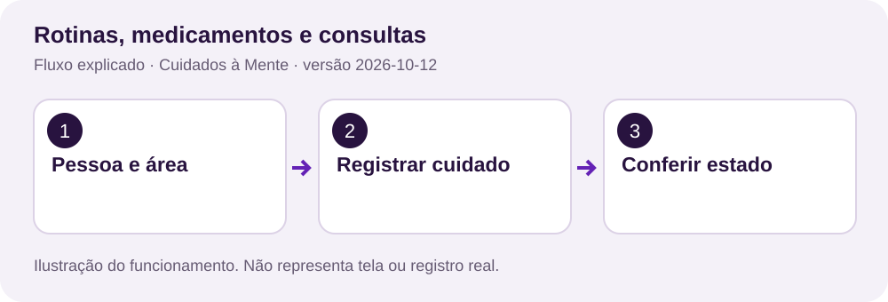

Leia o trecho e identifique os sinais. As páginas seguintes ligam cada construção a uma regra do aplicativo e a um exercício.

## 1. Como ler um trecho

TypeScript descreve telas, tipos e chamadas do aplicativo. Java implementa a API. SQL descreve consultas e persistência. Python cuida da cópia e restauração. Parênteses recebem argumentos; chaves agrupam blocos ou objetos; colchetes representam listas ou acesso a elementos.


## 2. Tipos e campos opcionais


Fonte: `src/core/api/cliente-api.ts`, linha 53. Os números à esquerda são as linhas reais.

```typescript
053 | export type Registro = {
054 |   id: string;
055 |   idosoId: string;
056 |   tipo: TipoRegistro;
057 |   titulo: string;
058 |   data: string;
059 |   horario: string;
060 |   detalhes: string;
061 |   status: 'pendente' | 'concluido';
062 |   categoria?: string;
063 |   midia?: string;
064 |   versao: number;
065 |   planoId?: string;
066 |   fuso?: string;
067 |   sincronizacaoPendente?: boolean;
068 | };
069 | 
```

type descreve o objeto. ? indica campo opcional; | descreve alternativas de status. versao participa da proteção contra edição concorrente.

**Exercício:** encontre a função completa no arquivo indicado e identifique entrada, regra de proteção e resultado.

## 3. Exportar uma função

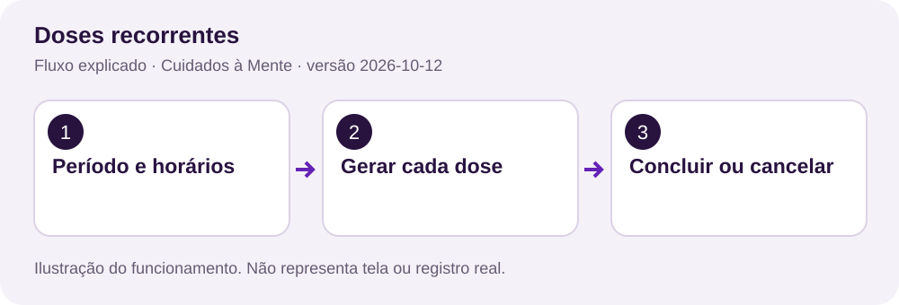

Fonte: `src/core/notificacoes/horario.ts`, linha 2. Os números à esquerda são as linhas reais.

```typescript
002 | export function instanteDoRegistro(data: string, horario: string, fuso?: string): Date | null {
003 |   if (!fuso) {
004 |     const local = new Date(data + 'T' + horario + ':00');
005 |     return Number.isNaN(local.getTime()) ? null : local;
006 |   }
007 |   try {
008 |     const [ano, mes, dia] = data.split('-').map(Number);
009 |     const [hora, minuto] = horario.split(':').map(Number);
010 |     const alvo = Date.UTC(ano, mes - 1, dia, hora, minuto);
011 |     const formatador = new Intl.DateTimeFormat('en-GB', {
012 |       timeZone: fuso,
013 |       year: 'numeric',
014 |       month: '2-digit',
015 |       day: '2-digit',
016 |       hour: '2-digit',
017 |       minute: '2-digit',
018 |       hourCycle: 'h23',
019 |     });
020 |     function partes(t: number) {
```

export permite importar a função. string e Date descrevem tipos. Date | null permite recusar um horário inválido. A função completa confere data, hora e fuso.

**Exercício:** encontre a função completa no arquivo indicado e identifique entrada, regra de proteção e resultado.

## 4. async, await e genéricos

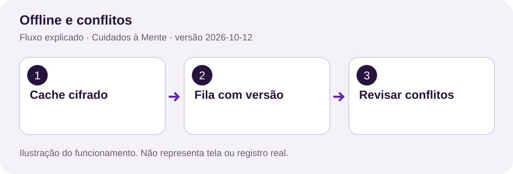

Fonte: `src/core/api/cliente-api.ts`, linha 273. Os números à esquerda são as linhas reais.

```typescript
273 | export async function requisitarApi<T>(
274 |   caminho: string,
275 |   metodo = 'GET',
276 |   corpo?: unknown,
277 | ): Promise<T> {
278 |   const tokenInicial = tokenSessao;
279 |   const versaoInicial = versaoAcesso;
280 |   // O mesmo recibo acompanha o primeiro envio e uma eventual repetição offline.
281 |   // Se o servidor gravou antes de a conexão cair, ele devolve o registro existente.
282 |   const dadosEnviados =
283 |     caminho === '/registros' && metodo === 'POST'
284 |       ? {
285 |           ...(corpo as Record<string, unknown>),
286 |           mutationId: (corpo as { mutationId?: string })?.mutationId || randomUUID(),
287 |         }
```

async devolve uma Promise. await espera uma operação. <T> descreve o tipo esperado da resposta; não valida JSON sozinho. O recibo de criação é preservado ao tentar novamente.

**Exercício:** encontre a função completa no arquivo indicado e identifique entrada, regra de proteção e resultado.

## 5. Efeito e limpeza no React

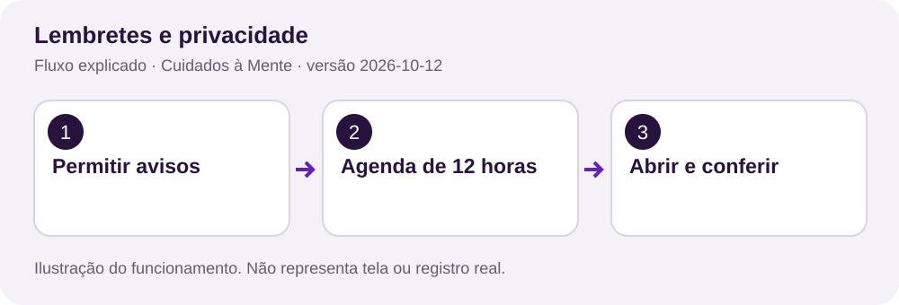

Fonte: `src/core/notificacoes/observador.tsx`, linha 8. Os números à esquerda são as linhas reais.

```typescript
008 |   useEffect(() => {
009 |     if (!usuario) {
010 |       void limparLembretes().catch(() => {});
011 |       return;
012 |     }
013 |     let ativo = true;
014 |     const atualizar = () => {
015 |       void atualizarLembretes(usuario).catch(() => {
016 |         if (ativo) {
017 |           void limparLembretes().catch(() => {});
018 |         }
019 |       });
020 |     };
021 |     atualizar();
022 |     const sub = AppState.addEventListener('change', (estado) => {
023 |       if (estado === 'active') {
024 |         atualizar();
025 |       }
026 |     });
027 |     const resposta = observarResposta(usuario, (tipo, idosoId) =>
```

useEffect conecta a conta à agenda. Sem usuário, limpa avisos. void permite iniciar a Promise sem retornar uma Promise como limpeza do efeito. Leia também a remoção de observadores e timer ao final.

**Exercício:** encontre a função completa no arquivo indicado e identifique entrada, regra de proteção e resultado.

## 6. Funções seta e listas

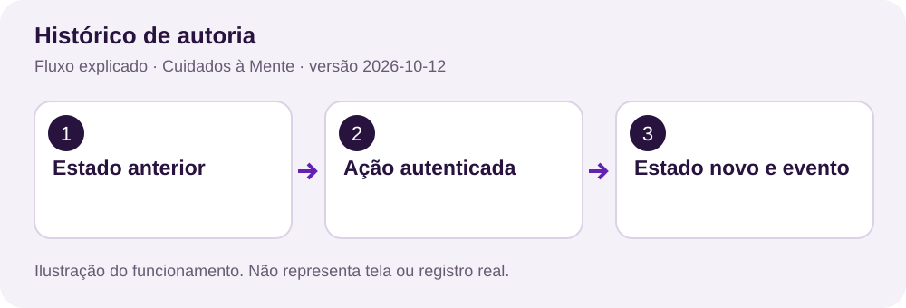

Fonte: `src/app/configuracoes.tsx`, linha 514. Os números à esquerda são as linhas reais.

```typescript
514 |   const descrever = (r: Partial<Registro>) =>
515 |     [r.titulo, r.data, r.horario, r.status, r.detalhes].filter(Boolean).join(' · ');
```

=> define uma função. A lista reúne campos do registro, filter(Boolean) retira valores vazios e join une o texto. O JSX chama a função para comparar a alteração local com o servidor.

**Exercício:** encontre a função completa no arquivo indicado e identifique entrada, regra de proteção e resultado.

## 7. Condição, adaptação e recursão

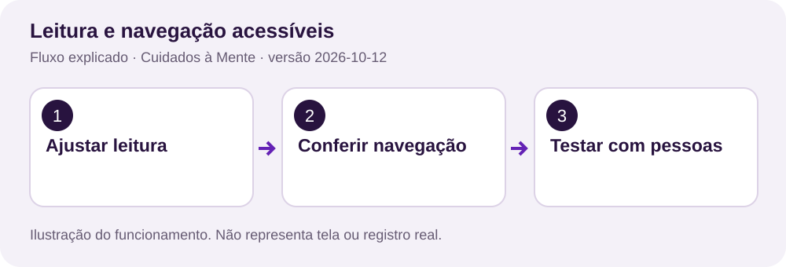

Fonte: `src/core/tema/paleta.ts`, linha 143. Os números à esquerda são as linhas reais.

```typescript
143 |     if (typeof item === 'number' && (chave === 'fontSize' || chave === 'lineHeight')) {
144 |       resultado[chave] = item * escala;
145 |     } else if (
146 |       typeof item === 'string' &&
147 |       /Color$|^color$/.test(chave) &&
148 |       chave !== 'shadowColor'
149 |     ) {
150 |       resultado[chave] = adaptarCor(
151 |         item,
152 |         tema,
153 |         chave === 'backgroundColor' ? 'fundo' : chave === 'color' ? 'texto' : 'borda',
154 |       );
155 |     } else {
156 |       resultado[chave] =
157 |         item && typeof item === 'object' ? adaptarEstilos(item, tema, escala) : item;
158 |     }
159 |   }
160 |   return resultado as T;
161 | }
```

typeof verifica tipos. && exige duas condições; || aceita uma alternativa. Objetos internos chamam adaptarEstilos novamente para aplicar tema e fonte.

**Exercício:** encontre a função completa no arquivo indicado e identifique entrada, regra de proteção e resultado.

## 8. Anotações e classes Java

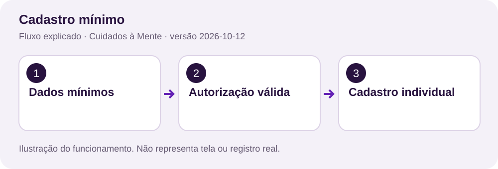

Fonte: `backend/src/main/java/com/cuidadosamente/backend/controlador/EvolucaoController.java`, linha 16. Os números à esquerda são as linhas reais.

```java
016 | @RestController
017 | @RequestMapping("/api")
018 | public class EvolucaoController {
019 | 
020 |   private final BancoDados banco;
021 |   private final CuidadosController cuidados;
022 |   private final EnvioEmail email;
023 |   private final JsonMapper json = JsonMapper.builder().build();
024 | 
025 |   @Value("${app.privacy-contact:}")
026 |   private String contatoPrivacidade = "";
027 | 
028 |   public EvolucaoController(BancoDados banco, CuidadosController cuidados, EnvioEmail email) {
029 |     this.banco = banco;
030 |     this.cuidados = cuidados;
031 |     this.email = email;
```

@RestController registra endpoints e @RequestMapping define o prefixo. private limita visibilidade; final preserva a referência. O construtor recebe banco, cuidados e envio de e-mail.

**Exercício:** encontre a função completa no arquivo indicado e identifique entrada, regra de proteção e resultado.

## 9. Validação numérica

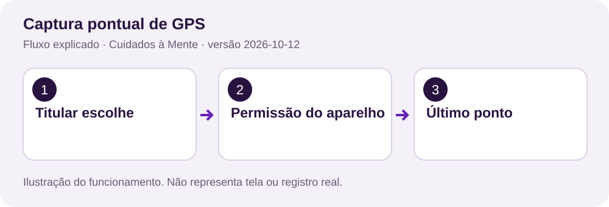

Fonte: `backend/src/main/java/com/cuidadosamente/backend/controlador/EvolucaoController.java`, linha 1080. Os números à esquerda são as linhas reais.

```java
1080 |   private double numero(Map<String, Object> dados, String key, double min, double max) {
1081 |     if (
1082 |       !(dados.get(key) instanceof Number n) ||
1083 |       !Double.isFinite(n.doubleValue()) ||
1084 |       n.doubleValue() < min ||
1085 |       n.doubleValue() > max
1086 |     ) {
1087 |       throw cuidados.erroDadosInvalidos("Valor inválido: " + key);
1088 |     }
1089 |     return n.doubleValue();
1090 |   }
```

instanceof exige Number. Double.isFinite rejeita infinito e NaN. Os limites mínimo e máximo recusam valores inválidos; throw interrompe a operação.

**Exercício:** encontre a função completa no arquivo indicado e identifique entrada, regra de proteção e resultado.

## 10. SQL parametrizado


Fonte: `backend/src/main/java/com/cuidadosamente/backend/infraestrutura/BancoDados.java`, linha 336. Os números à esquerda são as linhas reais.

```java
336 |   private void preencherParametros(PreparedStatement comandoSql, Object[] parametros)
337 |     throws SQLException {
338 |     for (int indice = 0; indice < parametros.length; indice++) {
339 |       comandoSql.setObject(indice + 1, parametros[indice]);
340 |     }
341 |   }
```

PreparedStatement recebe valores separados do SQL. JDBC começa no índice 1. Isso evita tratar texto digitado como instrução SQL.

**Exercício:** encontre a função completa no arquivo indicado e identifique entrada, regra de proteção e resultado.

## 11. Transação: tudo ou nada

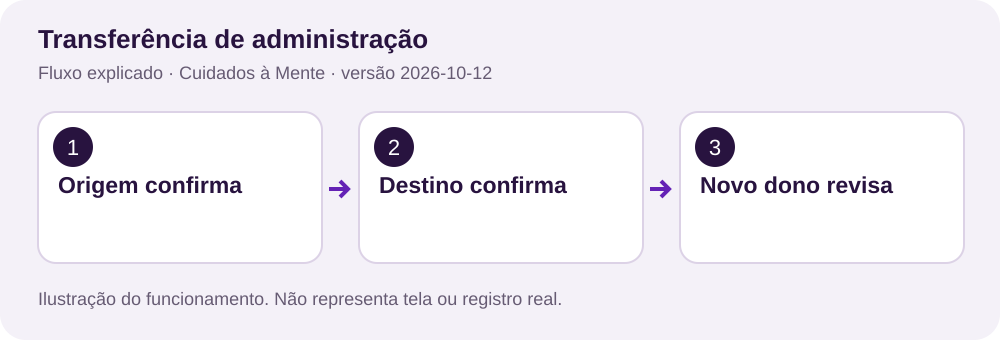

Fonte: `backend/src/main/java/com/cuidadosamente/backend/infraestrutura/BancoDados.java`, linha 289. Os números à esquerda são as linhas reais.

```java
289 |   public void executarTransacao(Object[]... comandos) {
290 |     try (Connection conexao = abrirConexao()) {
291 |       conexao.setAutoCommit(false);
292 |       try {
293 |         for (Object[] comando : comandos) {
294 |           try (PreparedStatement comandoSql = conexao.prepareStatement((String) comando[0])) {
295 |             preencherParametros(comandoSql, Arrays.copyOfRange(comando, 1, comando.length));
296 |             comandoSql.executeUpdate();
297 |           }
298 |         }
299 |         conexao.commit();
300 |       } catch (SQLException e) {
301 |         conexao.rollback();
302 |         throw e;
303 |       }
304 |     } catch (SQLException e) {
305 |       throw new ErroBancoDados(e);
306 |     }
307 |   }
```

Object[]... recebe comandos. setAutoCommit(false) inicia a unidade de trabalho. commit confirma tudo; rollback desfaz as gravações quando ocorre SQLException.

**Exercício:** encontre a função completa no arquivo indicado e identifique entrada, regra de proteção e resultado.

## 12. Versão e conflito


Fonte: `backend/src/main/java/com/cuidadosamente/backend/controlador/CuidadosController.java`, linha 1994. Os números à esquerda são as linhas reais.

```java
1994 |   void exigirVersao(Map<String, Object> anterior, Map<String, Object> dados) {
1995 |     if (!(dados.get("versao") instanceof Number v)) {
1996 |       throw new ResponseStatusException(
1997 |         HttpStatus.PRECONDITION_REQUIRED,
1998 |         "Recarregue o registro antes de salvar."
1999 |       );
2000 |     }
2001 |     if (v.doubleValue() != ((Number) anterior.get("versao")).doubleValue()) {
2002 |       throw new ResponseStatusException(
2003 |         HttpStatus.CONFLICT,
2004 |         "Outra pessoa alterou este registro. Recarregue e confira as diferenças antes de salvar."
2005 |       );
2006 |     }
2007 |   }
```

A versão precisa ser informada. Ausência gera 428; versão diferente gera 409. Essa comparação preserva a edição feita por outra pessoa.

**Exercício:** encontre a função completa no arquivo indicado e identifique entrada, regra de proteção e resultado.

## 13. Laços e geração de doses


Fonte: `backend/src/main/java/com/cuidadosamente/backend/controlador/EvolucaoController.java`, linha 731. Os números à esquerda são as linhas reais.

```java
731 |       for (LocalDate dia = dataInicial; !dia.isAfter(dataFinal); dia = dia.plusDays(intervalo)) {
732 |         for (String hora : horarios) {
733 |           String registroId = UUID.randomUUID().toString();
734 |           doses++;
735 |           comandos.add(new Object[] {
736 |             "INSERT INTO registros(id,owner_id,idoso_id,tipo,titulo,data,horario,detalhes,status,plano_id,fuso) VALUES(?,?,?,'medicamentos',?,?,?,?, 'pendente',?,?)",
737 |             registroId,
738 |             cuidados.donoDosDados(id),
739 |             id,
740 |             titulo,
741 |             dia.toString(),
742 |             hora,
743 |             detalhes,
744 |             planoId,
745 |             fuso,
746 |           });
747 |           comandos.add(
748 |             cuidados.evento(
749 |               id,
750 |               usuarioId,
751 |               "medicamentos",
752 |               registroId,
753 |               "dose_programada",
754 |               Map.of(),
755 |               Map.of("plano", planoId, "titulo", titulo, "data", dia.toString(), "horario", hora)
756 |             )
757 |           );
```

O laço externo avança dias pelo intervalo; o interno percorre horários. UUID identifica cada dose. A transação da função completa grava os registros e seus eventos.

**Exercício:** encontre a função completa no arquivo indicado e identifique entrada, regra de proteção e resultado.

## 14. Permissão antes de ler

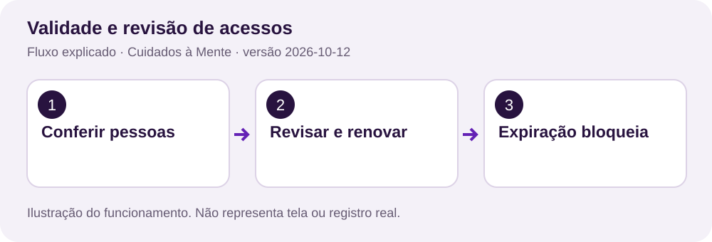

Fonte: `backend/src/main/java/com/cuidadosamente/backend/controlador/CuidadosController.java`, linha 1586. Os números à esquerda são as linhas reais.

```java
1586 |   void exigirPermissao(String idosoId, String usuarioId, String permissao) {
1587 |     validarAcessoIdoso(idosoId, usuarioId);
1588 |     if (!permissoesEfetivas(idosoId, usuarioId).contains(permissao)) {
1589 |       throw new ResponseStatusException(
1590 |         HttpStatus.FORBIDDEN,
1591 |         "Sem permissão para " + permissao.replace('_', ' ') + "."
1592 |       );
1593 |     }
1594 |   }
1595 | 
```

validarAcessoIdoso confere a pessoa e o vínculo. contains exige a ação exata, por exemplo ver_rotinas. FORBIDDEN recusa a operação da conta sem essa permissão.

**Exercício:** encontre a função completa no arquivo indicado e identifique entrada, regra de proteção e resultado.

## 15. Hash de token e senha

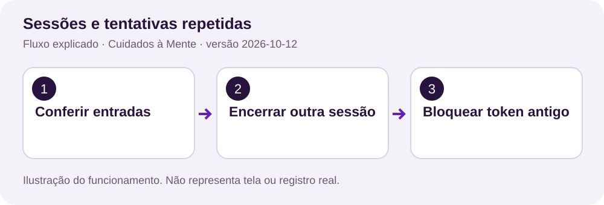

Fonte: `backend/src/main/java/com/cuidadosamente/backend/controlador/CuidadosController.java`, linha 2106. Os números à esquerda são as linhas reais.

```java
2106 |   String gerarHash(String token) {
2107 |     // SHA-256 é adequado para tokens aleatórios de alta entropia. Senhas de
2108 |     // usuário usam BCrypt, que é deliberadamente mais lento.
2109 |     try {
2110 |       return HexFormat.of().formatHex(
2111 |         MessageDigest.getInstance("SHA-256").digest(token.getBytes(StandardCharsets.UTF_8))
2112 |       );
2113 |     } catch (NoSuchAlgorithmException e) {
2114 |       throw new IllegalStateException(e);
2115 |     }
2116 |   }
```

SHA-256 transforma um token aleatório em hash e HexFormat o representa em texto. As senhas humanas usam BCrypt em outros métodos.

**Exercício:** encontre a função completa no arquivo indicado e identifique entrada, regra de proteção e resultado.

## 16. Chave do cache local


Fonte: `src/core/offline/armazenamento.native.ts`, linha 48. Os números à esquerda são as linhas reais.

```typescript
048 |   let chave = await SecureStore.getItemAsync('cuidados.offline.key');
049 |   if (!chave) {
050 |     chave = Array.from(await Crypto.getRandomBytesAsync(32))
051 |       .map((n) => n.toString(16).padStart(2, '0'))
052 |       .join('');
053 |     await SecureStore.setItemAsync('cuidados.offline.key', chave);
054 |   }
055 |   const db = await SQLite.openDatabaseAsync('cuidados-offline.db');
056 |   try {
057 |     const suporte = await db.getFirstAsync<Record<string, string>>('PRAGMA cipher_version');
```

SecureStore guarda a chave local. Bytes aleatórios viram hexadecimal. A seguir, a abertura exige SQLCipher e aplica a chave antes de criar tabelas.

**Exercício:** encontre a função completa no arquivo indicado e identifique entrada, regra de proteção e resultado.

## 17. Datas e fuso


Fonte: `src/core/notificacoes/horario.ts`, linha 11. Os números à esquerda são as linhas reais.

```typescript
011 |     const formatador = new Intl.DateTimeFormat('en-GB', {
012 |       timeZone: fuso,
013 |       year: 'numeric',
014 |       month: '2-digit',
015 |       day: '2-digit',
016 |       hour: '2-digit',
017 |       minute: '2-digit',
018 |       hourCycle: 'h23',
019 |     });
020 |     function partes(t: number) {
021 |       return Object.fromEntries(
022 |         formatador.formatToParts(new Date(t)).map((p) => [p.type, p.value]),
023 |       );
024 |     }
```

Intl.DateTimeFormat obtém partes da data no fuso do plano. A função completa ajusta o instante UTC e recusa horários inexistentes por mudança sazonal.

**Exercício:** encontre a função completa no arquivo indicado e identifique entrada, regra de proteção e resultado.

## 18. Proteção de HTML

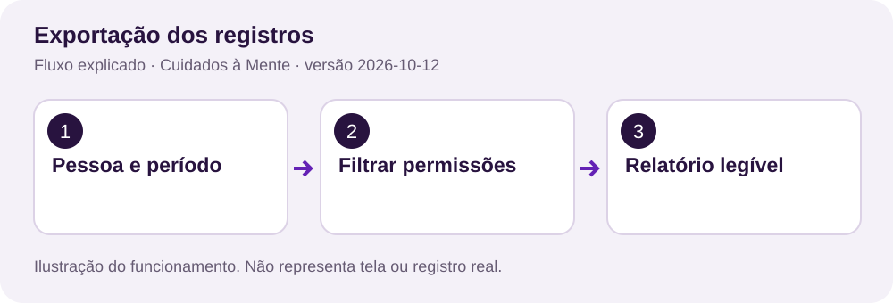

Fonte: `src/features/cuidados/relatorios/relatorio-cuidados.ts`, linha 5. Os números à esquerda são as linhas reais.

```typescript
005 | const escaparHtml = (s: unknown) =>
006 |   String(s ?? '').replace(
007 |     /[&<>"']/g,
008 |     (c) => ({ '&': '&amp;', '<': '&lt;', '>': '&gt;', '"': '&quot;', "'": '&#39;' })[c]!,
009 |   );
```

replace converte &, <, > e aspas em entidades HTML. O relatório usa esta função em cada campo digitado. A geração foi extraída da tela mantendo o mesmo conteúdo.

**Exercício:** encontre a função completa no arquivo indicado e identifique entrada, regra de proteção e resultado.

## 19. Contexto e streams em Python

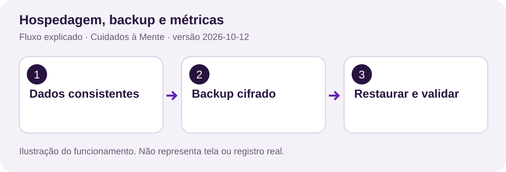

Fonte: `scripts/backup.py`, linha 37. Os números à esquerda são as linhas reais.

```python
037 | def cifrar(origem: Path, destino: Path, segredo: bytes):
038 |     nonce = os.urandom(12)
039 |     ctx = Cipher(algorithms.AES(segredo), modes.GCM(nonce)).encryptor()
040 |     ctx.authenticate_additional_data(MAGIC)
041 |     with origem.open("rb") as entrada, destino.open("xb") as saida:
042 |         saida.write(MAGIC + nonce)
043 |         for b in iter(lambda: entrada.read(65536), b""):
044 |             saida.write(ctx.update(b))
045 |         saida.write(ctx.finalize() + ctx.tag)
046 |     os.chmod(destino, 0o600)
```

def declara a função. with fecha arquivos mesmo em falhas. AES-GCM cifra e autentica a cópia; a leitura por blocos limita o uso de memória.

**Exercício:** encontre a função completa no arquivo indicado e identifique entrada, regra de proteção e resultado.

## 20. Glossário rápido

| Termo | Significado neste projeto |
| --- | --- |
| API | Endpoints HTTP que conferem acesso e manipulam dados |
| Token | Credencial aleatória enviada em Authorization |
| UUID | Identificador de conta, dose, arquivo ou evento |
| Hash | Resultado de transformação que evita persistir token bruto |
| Versão | Número incrementado a cada atualização de registro |
| Cache | Cópia de leitura com validade, cifrada no nativo |
| Fila | Alterações locais ainda não confirmadas pelo servidor |
| Transação | Gravações que confirmam ou falham juntas |
| UTC / fuso | Instante global e regra local para exibir/programar horário |
| Retenção | Prazo técnico para conservar e limpar uma categoria de dados |

Não remova validação de acesso para facilitar um teste. Crie contas e dados sintéticos e confira respostas permitidas e recusadas.
## 21. Condições que adaptam a interface


Fonte: `src/components/layout/estrutura-aplicativo.tsx`, linha 63. Os números à esquerda são as linhas reais.

```typescript
063 |   const desktop = width >= 1024;
```

A largura da janela escolhe o menu lateral a partir de 1024 pixels. Em telas menores, o aplicativo mostra uma barra inferior e o botão Mais.

Fonte: `src/components/layout/estrutura-aplicativo.tsx`, linha 111. Os números à esquerda são as linhas reais.

```typescript
111 |   const leituraAmpliada = (usuario?.preferencias?.font_scale || 1) * fontScale >= 1.4;
112 |   const prioridade: SecaoAplicativo[] = elder
113 |     ? leituraAmpliada
114 |       ? ['inicio', 'emergencia', 'perfil']
115 |       : ['inicio', 'rotinas', 'emergencia', 'perfil']
116 |     : leituraAmpliada
117 |       ? ['inicio', 'rotinas', 'perfil']
118 |       : ['inicio', 'rotinas', 'memorias', 'perfil'];
```

O tamanho escolhido na conta é combinado com a escala de fonte do aparelho. Com letras ampliadas, uma opção passa para Mais, deixando espaço para ler os rótulos. As permissões continuam filtrando os destinos.

O operador >= compara dois números. O operador * combina as escalas. A expressão condição ? valorA : valorB escolhe qual lista usar; a lista escolhida ainda passa pelo filtro de permissões.

## 22. Convenções de legibilidade

Uma declaração por instrução facilita localizar estados e variáveis. Blocos com chaves deixam visíveis os limites de condições e laços. Nomes descrevem a finalidade: estilosDaTela, ocupado, banco e usuarioId.

Uma constante como MAXIMO_ALTERACOES_PENDENTES mantém o mesmo limite de 100 itens, mas explica o significado do número. Uma função como gerarHtmlRelatorio concentra uma responsabilidade. As chaves de JSON, SQL, rotas e componentes públicos permanecem compatíveis.

Use npm run format para formatar e npm run format:check para conferir o padrão. Tipos, lint e testes de comportamento continuam necessários depois de uma mudança.

