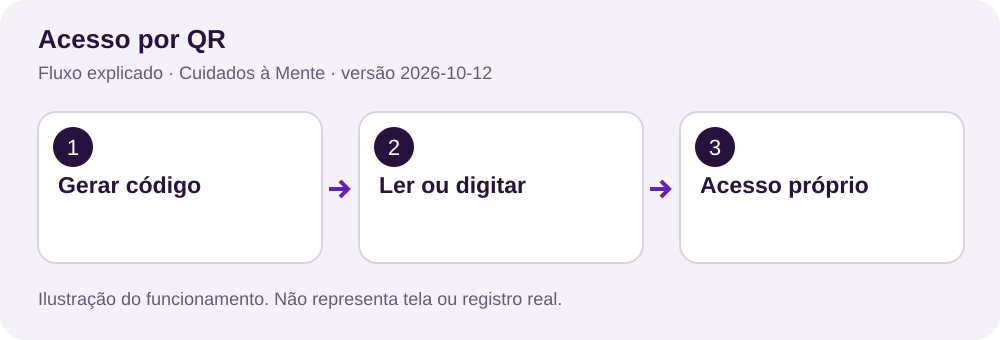
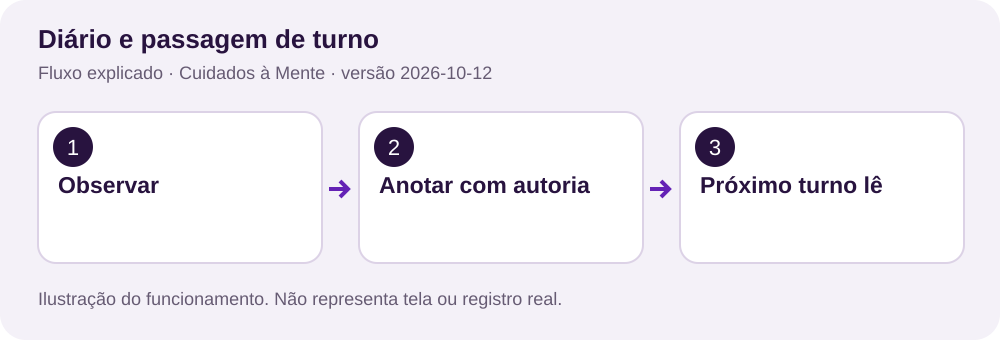
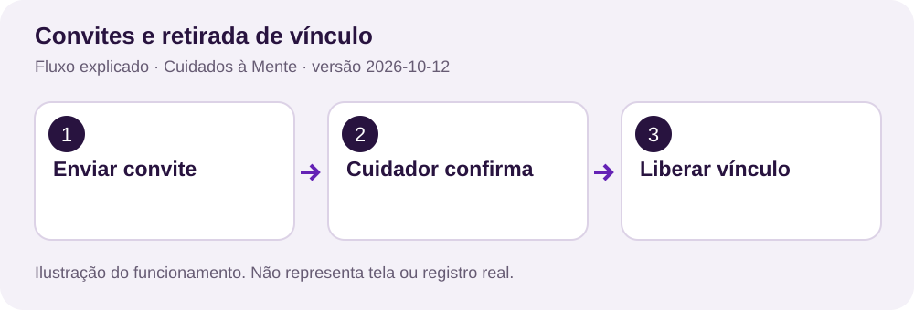
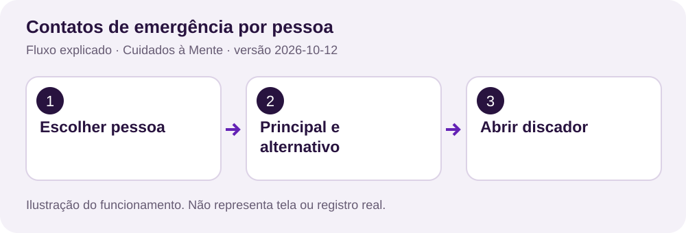
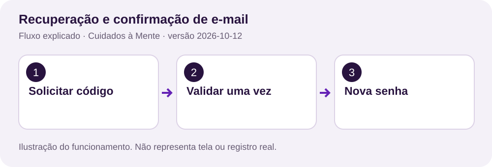
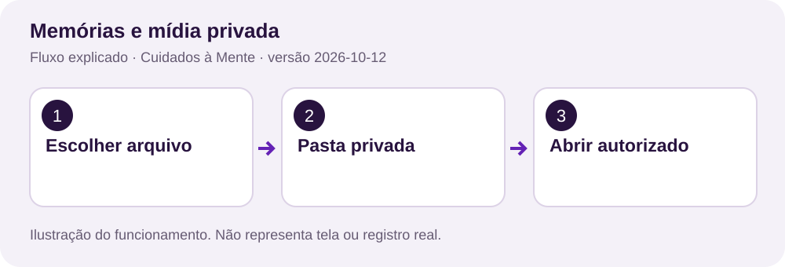
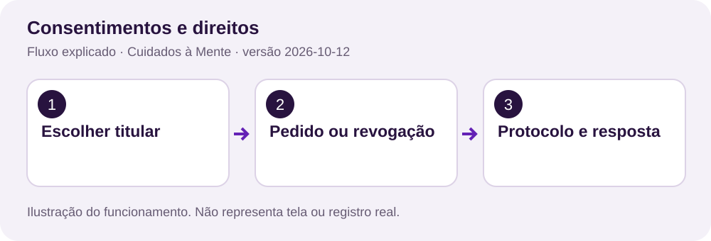
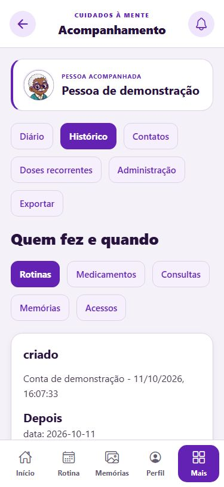
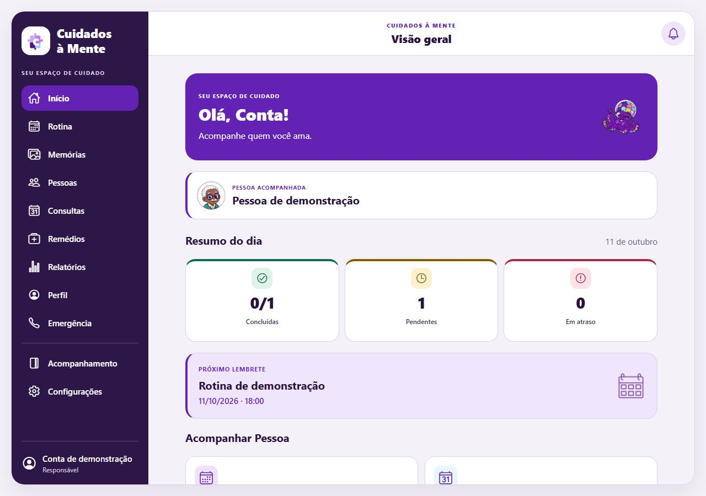

# Manual do usuário — Cuidados à Mente

Versão 2026-10-12. Faça cada tarefa, reconheça o resultado e confira os limites. As figuras explicam o funcionamento; os exemplos são sintéticos.


Leia uma tarefa por vez. Localize a tela, siga os passos e compare o resultado esperado. As últimas páginas mostram telas de demonstração e exemplos opcionais de código.

## 1. Comece aqui

O Idoso acessa o próprio cuidado. O Cuidador acompanha cadastros autorizados. O Responsável administra seus cadastros. Confira o nome da pessoa antes de escrever, concluir ou compartilhar.

| Quero fazer | Onde encontrar |
| --- | --- |
| Ver pendências | Painel e abas de registros |
| Escrever passagem de turno | Acompanhamento > Diário |
| Programar várias doses | Acompanhamento > Doses recorrentes |
| Ajustar letras e avisos | Perfil > Configurações |
| Rever compartilhamento | Permissões e Administração |
| Pedir correção ou revogar | Configurações > Privacidade |

Na web, use conexão com a API. Lembretes e GPS pontual são nativos. Offline exige build própria com SQLCipher; o Expo Go não valida esse recurso. Resumos e atividades do dia apoiam a organização, sem avaliar saúde.

## 2. Cadastro mínimo

**Onde:** Tela inicial e Contas de idosos.


1. Informe nome, e-mail e senha na conta adulta.
2. Leia os documentos e confirme os aceites separadamente.
3. No cadastro da pessoa, informe nome e confirme autorização válida.

**Resultado esperado:** CPF, RG, nascimento, contato e endereço são opcionais.

**O que conferir:** O perfil Responsável não comprova representação legal.

## 3. Acesso por QR

**Onde:** Contas de idosos e botão QR da tela inicial.



1. Escolha a pessoa e gere o QR no acesso adulto.
2. No aparelho da pessoa, leia ou digite o código. Se o proprietário preparou credenciais, também pode usar e-mail e senha.
3. Confira o nome e aceite os documentos quando solicitado.

**Resultado esperado:** A conta idosa acessa somente a pessoa vinculada.

**O que conferir:** QR vale dez minutos e é de uso único. Desconectar encerra sessões, desativa a senha opcional e preserva registros.

## 4. Rotinas, medicamentos e consultas

**Onde:** Painel e abas dos registros.


1. Selecione a pessoa antes de criar ou editar.
2. Informe título, data, horário e detalhes necessários.
3. Use Concluir ou Reabrir conforme a permissão.

**Resultado esperado:** Pesquisa e resumos usam apenas registros autorizados. Concluir registra a declaração do usuário.

**O que conferir:** O aplicativo não mede ingestão, prescreve doses nem agenda consultas com estabelecimentos.

## 5. Histórico de autoria

**Onde:** Acompanhamento > Histórico.


1. Selecione a pessoa e a área.
2. Leia ação, autor e instante.
3. Compare Antes e Depois para entender uma correção.

**Resultado esperado:** Novas mudanças geram eventos separados, na mesma transação do registro.

**O que conferir:** Não reconstrói autoria antiga. Exibe até 300 eventos; retenção padrão de 365 dias.

## 6. Diário e passagem de turno

**Onde:** Acompanhamento > Diário.



1. Escolha Observação, Passagem de turno ou Correção.
2. Escreva o necessário para o cuidado.
3. Salve e confira autor e horário. Para corrigir, acrescente outra entrada.

**Resultado esperado:** As entradas anteriores são preservadas. Adultos usam permissões de rotina.

**O que conferir:** Exibe até 200 entradas. Não substitui documentação clínica formal.

## 7. Convites e retirada de vínculo

**Onde:** Perfil > Permissões e Configurações.



1. O responsável informa o e-mail de uma conta de cuidador existente.
2. O cuidador aceita ou recusa em Configurações.
3. Para sair, use Acompanhamento > Administração > Retirar meu acesso.

**Resultado esperado:** Antes do aceite, os registros continuam inacessíveis. A retirada elimina os acessos do vínculo.

**O que conferir:** Convite vale sete dias. Antes do aceite aparece quem convidou, sem dados de cuidado.

## 8. Validade e revisão de acessos

**Onde:** Acompanhamento > Administração > Revisar acessos.


1. Confira quem continua acompanhando a pessoa.
2. Revise as permissões e informe nova validade em AAAA-MM-DD.
3. Confirme a revisão ou retire acessos antigos.

**Resultado esperado:** Vínculos aceitos começam com 90 dias. O servidor bloqueia acesso vencido.

**O que conferir:** Renovação limitada a um ano. Vínculos antigos recebem 90 dias a partir da migração.

## 9. Transferência de administração

**Onde:** Acompanhamento > Administração e Configurações do destinatário.


1. Informe e-mail do novo responsável e sua senha.
2. O destinatário confirma com a própria senha.
3. O novo dono revisa vínculos e gera outro QR.

**Resultado esperado:** Preserva registros e retira acesso do administrador anterior.

**O que conferir:** Proposta vale 24 horas. A troca técnica não transfere representação jurídica.

## 10. Contatos de emergência por pessoa

**Onde:** Acompanhamento > Contatos e Idoso > Emergência.



1. Confira a pessoa selecionada.
2. Cadastre contato principal e, se necessário, alternativo.
3. Na emergência, escolha contato e confirme no discador.

**Resultado esperado:** Pessoas diferentes podem ter contatos diferentes. Alterações são auditadas.

**O que conferir:** Ligação depende de aparelho, rede e confirmação; não há acionamento automático.

## 11. Doses recorrentes

**Onde:** Acompanhamento > Doses recorrentes.


1. Copie o plano já orientado: início, fim, horários e intervalo de dias.
2. Confira o fuso e toque em Programar doses.
3. Cada dose fica pendente; cancelar remove só futuras pendentes.

**Resultado esperado:** Dois horários em dois dias geram quatro doses com estados próprios.

**O que conferir:** Até um ano, oito horários e 730 doses. Intervalo inteiro de 1 a 30 dias. Fuso do plano é preservado.

## 12. Lembretes e privacidade

**Onde:** Perfil > Configurações > Lembretes do cuidado.


1. Ative no nativo e permita notificações no sistema.
2. Escolha a antecedência das consultas; prefira aviso genérico em aparelho compartilhado.
3. Abra diariamente e confira o registro ao tocar no aviso.

**Resultado esperado:** O aviso genérico não revela o medicamento. Tocar não conclui o registro.

**O que conferir:** Até 50 avisos nas próximas 12 horas, antes da sessão expirar. Web não agenda; entrega precisa de validação física.

## 13. Offline e conflitos

**Onde:** Perfil > Configurações > Sincronização offline.


1. Use build nativa com SQLCipher e ative o cache.
2. Atualize acessos com rede; consulte e altere registros armazenados por até 15 minutos.
3. Reconecte. Em conflito, compare versões, copie o necessário e descarte a alteração local antes de editar o servidor.

**Resultado esperado:** Fila cifrada, até 100 alterações. O servidor revalida acesso e versão.

**O que conferir:** Cache de até 5 milhões de caracteres, sem mídias. Revogação só é conhecida ao reconectar. Saída, troca de sessão ou recusa de acesso limpa cache e fila.

## 14. Recuperação e confirmação de e-mail

**Onde:** Entrar > Recuperar acesso e Configurações.



1. Solicite um código pelo e-mail da conta.
2. Cole o código recebido e escolha nova senha na recuperação.
3. Entre novamente; para verificar e-mail, use o fluxo de confirmação em Configurações.

**Resultado esperado:** Códigos de uso único ficam como hash; recuperar remove todas as sessões da conta.

**O que conferir:** Validade de 30 minutos. Exige Resend, chave e remetente verificado. Sem configuração, a tela informa indisponibilidade.

## 15. Sessões e tentativas repetidas

**Onde:** Perfil > Configurações > Sessões abertas.


1. Confira entrada atual, outras sessões e datas.
2. Encerre uma sessão ou todas as outras.
3. Se suspeitar de acesso indevido, recupere a senha.

**Resultado esperado:** IDs de sessão permitem gerenciar acessos sem expor tokens utilizáveis.

**O que conferir:** Sessão dura 12 horas. Login: 10 tentativas por e-mail; autenticação: 40 POSTs por IP em 15 minutos. Proxy exige atenção operacional.

## 16. Captura pontual de GPS

**Onde:** Idoso > Configurações > Compartilhar minha posição.


1. O responsável habilita compartilhamento e cuidadores individualmente.
2. A pessoa idosa escolhe compartilhar no próprio aparelho e permite localização.
3. Toque em Enviar minha posição agora; para interromper, apague o ponto e desligue compartilhamento.

**Resultado esperado:** Só a conta idosa vinculada envia posição; a API guarda o ponto mais recente com precisão e horário.

**O que conferir:** Sem rastreamento contínuo. Mais de 5 minutos é desatualizado; após 24 horas o ponto é retirado. Mapa externo é opcional.

## 17. Memórias e mídia privada

**Onde:** Memórias > Adicionar e Arquivo privado.



1. Escolha a pessoa, a categoria e um arquivo.
2. Salve a memória com título e referência.
3. Para abrir, toque no arquivo; a API confere acesso novamente.

**Resultado esperado:** Arquivos novos ficam fora do SQLite, identificados como media:UUID, sem URL pública.

**O que conferir:** JPEG, PNG, WebP, MP3, WAV e MP4; 10 MB por arquivo, 200 MB por pessoa. Upload sem memória expira em 24 horas.

## 18. Exportação dos registros

**Onde:** Acompanhamento > Exportar.


1. Selecione pessoa e período de até um ano.
2. Na web, baixe HTML e imprima ou salve PDF no navegador.
3. No nativo, gere o PDF e escolha destino de compartilhamento.

**Resultado esperado:** Inclui somente as áreas autorizadas, sem CPF, RG, endereço, GPS ou arquivos.

**O que conferir:** A cópia exportada fica fora do controle do aplicativo; escolha o destinatário com cuidado.

## 19. Leitura e navegação acessíveis

**Onde:** Perfil > Configurações > Aparência e leitura.


1. Escolha tema claro ou escuro e fonte de 100% a 160%.
2. Salve e confira rolagem e botões com fonte do sistema ampliada.
3. Use menu e abas autorizadas; valide também com leitor de tela.

**Resultado esperado:** Fontes e altura de linha aumentam juntas. Botões informam estados e ícones decorativos deixam de disputar foco.

**O que conferir:** Correções não substituem teste com pessoas idosas, TalkBack e VoiceOver. Veja ACESSIBILIDADE.md.

## 20. Consentimentos e direitos

**Onde:** Configurações > Privacidade, consentimentos e meus direitos.



1. Escolha Minha conta ou pessoa cujo cadastro administra.
2. Registre o pedido, guarde protocolo e acompanhe resposta.
3. Indique autorização válida e digite AUTORIZAR ou REVOGAR para confirmar.

**Resultado esperado:** Revogar bloqueia cuidado, apaga posição GPS e invalida QR; a central continua acessível sem novo aceite.

**O que conferir:** Declaração não prova representação. O contato real do controlador precisa ser definido. Providências e cópias dependem do processo administrativo.

## 21. Hospedagem, backup e métricas

**Onde:** deploy/ e scripts/backup.py — ferramentas do mantenedor.


1. Configure domínio, HTTPS, uma API e disco persistente conforme OPERACAO.md.
2. Configure chave fora do projeto e o timer diário; backup pausa a API brevemente.
3. Restaure em pasta nova e valide antes de planejar troca do ambiente.

**Resultado esperado:** Pacote AES-256-GCM reúne SQLite e mídia, manifesto e hashes. Métricas têm só contagens e duração.

**O que conferir:** Infraestrutura e contas externas não foram ativadas. Docker, systemd e nuvem requerem teste no servidor; restauração local usa dados sintéticos.

## 22. Se algo não funcionar

| Situação | Como agir |
| --- | --- |
| Sessão expirada | Entre novamente; cache e fila pertencem à sessão. |
| Sem permissão | Peça revisão ao administrador; link não concede acesso. |
| Conflito | Compare servidor e conteúdo local antes de repetir. |
| E-mail indisponível | O mantenedor precisa conectar remetente e Resend. |
| Sem SQLCipher | Use build nativa própria ou mantenha conexão. |
| Sem lembrete | Confira permissão, horários, sessão e agenda de 12 horas. |
| Sem posição | O titular precisa enviar captura recente do próprio aparelho. |
| Sem mídia | Confira sessão, permissão e arquivo; links dependem de terceiros. |

## 23. Código por trás de cinco ações

Parte opcional para quem deseja estudar. O manual-aula mostra todas as funcionalidades, com linhas reais e explicações.

### Doses recorrentes

Fonte: `backend/src/main/java/com/cuidadosamente/backend/controlador/EvolucaoController.java`, linha 731. Os números à esquerda são as linhas reais.

```java
731 |       for (LocalDate dia = dataInicial; !dia.isAfter(dataFinal); dia = dia.plusDays(intervalo)) {
732 |         for (String hora : horarios) {
733 |           String registroId = UUID.randomUUID().toString();
734 |           doses++;
735 |           comandos.add(new Object[] {
736 |             "INSERT INTO registros(id,owner_id,idoso_id,tipo,titulo,data,horario,detalhes,status,plano_id,fuso) VALUES(?,?,?,'medicamentos',?,?,?,?, 'pendente',?,?)",
737 |             registroId,
738 |             cuidados.donoDosDados(id),
739 |             id,
740 |             titulo,
741 |             dia.toString(),
742 |             hora,
743 |             detalhes,
744 |             planoId,
745 |             fuso,
746 |           });
747 |           comandos.add(
748 |             cuidados.evento(
```

O laço percorre dias e horários. Cada combinação recebe UUID, registro pendente e evento dose_programada.

### Lembretes e privacidade

Fonte: `src/core/notificacoes/lembretes.native.ts`, linha 195. Os números à esquerda são as linhas reais.

```typescript
195 |             body: preferencias.notification_details
196 |               ? r.titulo + ' - abra o aplicativo para conferir e registrar.'
197 |               : 'Há um cuidado programado. Abra o aplicativo para conferir.',
198 |             data: { conta: usuario.id, tipo: r.tipo, idosoId: r.idosoId },
199 |             sound: 'default',
200 |           },
201 |           trigger: {
202 |             type: Notifications.SchedulableTriggerInputTypes.DATE,
203 |             date: data,
204 |             channelId: CANAL,
205 |           },
206 |         });
207 |         // O logout pode ocorrer enquanto a chamada nativa ainda está agendando.
208 |         if (versao !== geracao) {
209 |           await Notifications.cancelScheduledNotificationAsync(identifier);
210 |           return 0;
```

A escolha muda texto detalhado ou genérico. O aviso leva conta e área; o gatilho DATE agenda o instante calculado.

### Histórico de autoria

Fonte: `backend/src/main/java/com/cuidadosamente/backend/controlador/CuidadosController.java`, linha 2018. Os números à esquerda são as linhas reais.

```java
2018 |     var estadoAnterior = new LinkedHashMap<>(antes);
2019 |     var estadoPosterior = new LinkedHashMap<>(depois);
2020 |     estadoAnterior.remove("midia");
2021 |     estadoPosterior.remove("midia");
2022 |     return new Object[] {
2023 |       "INSERT INTO audit_events(id,idoso_id,actor_id,actor_name,tipo,entity_id,action,occurred_at,before_json,after_json) VALUES(?,?,?,?,?,?,?,?,?,?)",
2024 |       UUID.randomUUID().toString(),
2025 |       pessoa,
2026 |       autor,
2027 |       buscarUsuario(autor).get("nome"),
2028 |       tipo,
2029 |       entidade,
2030 |       acao,
2031 |       Instant.now().toString(),
2032 |       conversorJson.writeValueAsString(estadoAnterior),
2033 |       conversorJson.writeValueAsString(estadoPosterior),
2034 |     };
2035 |   }
2036 | 
2037 |   Map<String, Object> contatoEmergencia(String pessoa) {
2038 |     var contatos = banco.consultar(
2039 |       "SELECT nome,telefone,nome_alternativo AS " +
```

O servidor usa o autor autenticado, copia os estados, retira mídia e grava UUID e horário UTC na trilha.

### Offline e conflitos

Fonte: `src/core/offline/armazenamento.native.ts`, linha 57. Os números à esquerda são as linhas reais.

```typescript
057 |     const suporte = await db.getFirstAsync<Record<string, string>>('PRAGMA cipher_version');
058 |     if (!suporte || !Object.values(suporte)[0]) {
059 |       throw new Error(
060 |         'Este aplicativo não tem SQLCipher. Instale uma build com armazenamento protegido para usar offline.',
061 |       );
062 |     }
063 |     // A chave é hexadecimal gerada localmente; nenhum texto de usuário entra no PRAGMA.
064 |     await db.execAsync('PRAGMA key = "x\'' + chave + '\'";');
065 |     await db.execAsync(
066 |       'CREATE TABLE IF NOT EXISTS cache (chave TEXT PRIMARY KEY, escopo TEXT NOT ' +
067 |         'NULL, dados TEXT NOT NULL, expires INTEGER NOT NULL); CREATE TABLE IF NOT ' +
068 |         'EXISTS pending (id TEXT PRIMARY KEY, escopo TEXT NOT NULL, caminho TEXT NOT ' +
069 |         'NULL, metodo TEXT NOT NULL, corpo TEXT NOT NULL, erro TEXT NOT NULL DEFAULT ' +
070 |         "'', instante INTEGER NOT NULL);",
071 |     );
072 |     banco = db;
073 |     return db;
074 |   } catch (erro) {
075 |     await db.closeAsync().catch(() => {});
```

O código exige SQLCipher. A chave aleatória fica no SecureStore e é aplicada antes das tabelas privadas.

### Consentimentos e direitos

Fonte: `backend/src/main/java/com/cuidadosamente/backend/controlador/EvolucaoController.java`, linha 961. Os números à esquerda são as linhas reais.

```java
961 |       if (!permitido) {
962 |         comandos.add(new Object[] { "DELETE FROM location_points WHERE idoso_id=?", id });
963 |         comandos.add(new Object[] { "DELETE FROM location_sharing WHERE idoso_id=?", id });
964 |         comandos.add(new Object[] { "DELETE FROM qr_access WHERE idoso_id=?", id });
965 |       }
966 |       comandos.add(
967 |         cuidados.evento(
968 |           id,
969 |           usuarioId,
970 |           "acesso",
971 |           id,
972 |           permitido ? "consentimento_registrado" : "consentimento_revogado",
973 |           Map.of(),
974 |           Map.of("representacao", papel)
975 |         )
976 |       );
```

Revogação remove ponto, compartilhamento e QR na transação. A validação central bloqueia novas operações de cuidado.

## 24. Tela do diário no celular


A aba marcada indica onde você está. Use Passagem de turno para a próxima equipe e Correção para acrescentar uma retificação. O conteúdo continua pela rolagem; a barra inferior preserva o tamanho de seus botões.

## 25. Tela do histórico



Escolha a categoria. Antes e Depois permitem conferir a alteração; eventos anteriores à atualização não ganham autoria retroativa.

## 26. Tela de leitura e avisos


Escolha o tamanho da letra e role para ajustar lembretes. A web exibe as preferências; entrega de aviso exige a build Android/iOS. As capturas usam uma conta de demonstração, sem dados pessoais reais.

## 27. Encontre seu caminho na nova interface


1. Veja a pessoa acompanhada e o resumo do dia no painel.
2. No celular, use Início, Rotina, Memórias e Perfil. Toque em Mais para acessar as demais telas. Com letras maiores, algumas opções passam ao menu.
3. No computador, use o menu lateral. O conteúdo fica centralizado e tem a mesma ordem do celular.



O perfil idoso prioriza Emergência. A cor roxa indica a área selecionada. Os cartões mostram também o nome do estado, para que você não precise interpretar apenas uma cor.

## 28. Contas preenchidas e acesso por senha

As três contas do conjunto local usam o banco persistente backend/data/cuidados.db e compartilham o mesmo cadastro fictício: Marina Costa (responsável), Lucas Martins (cuidador) e Antônio Costa (idoso). As credenciais são entregues separadamente no arquivo local work/contas-app/ACESSOS.md; não fazem parte deste manual.

1. Na entrada, escolha o perfil correspondente à conta.
2. Para o idoso, toque em Entrar com e-mail e senha. O QR permanece disponível.
3. Confira a pessoa acompanhada antes de abrir a rotina, os medicamentos, as consultas ou as memórias.
4. Explore o diário e os planos recorrentes pela conta adulta. O idoso acessa apenas os dados e ações permitidos ao seu perfil.

Os nomes, contatos, documentos, consultas, medicamentos e relatos deste conjunto são fictícios. Os registros ficam persistidos após fechar ou reiniciar o aplicativo. Consulte CONTAS_PREENCHIDAS.md para ver a quantidade de dados.

## 29. Atualização de organização do código

O clean code de 12/10/2026 reorganizou os fontes e atualizou os exemplos destes manuais. Os passos, telas, permissões e funcionalidades de uso permanecem os mesmos.

