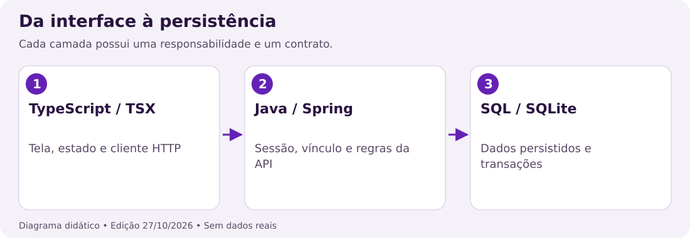
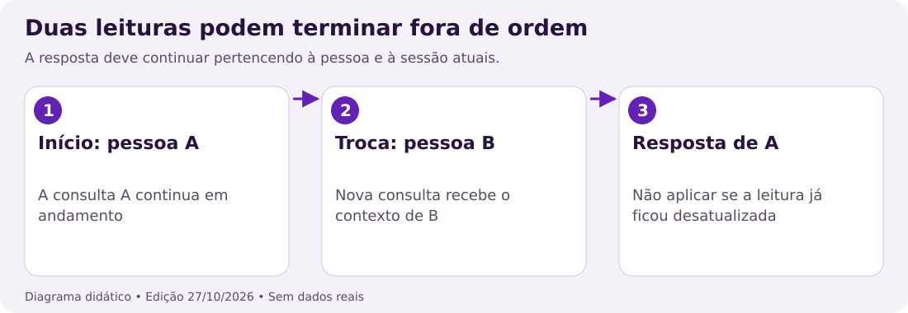
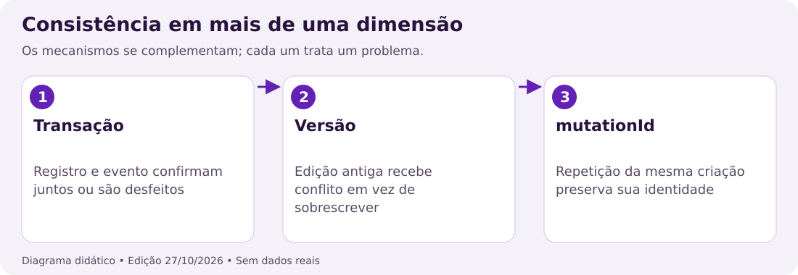

## 23. Roteiro de estudo e mapa das linguagens

Esta parte funciona como um curso de leitura do código. Os exemplos marcados como **didáticos** foram simplificados para ensinar uma construção; não são transcrições nem mudanças propostas para produção. Os trechos da primeira parte, acompanhados de arquivo e número de linha, são extraídos dos fontes. Nunca copie os números das linhas para um programa.



Comece por variáveis, objetos e funções. Depois estude componentes, estado e efeitos. Só então acompanhe a requisição até Java e SQL. Python é uma trilha de operação: serve à cópia de segurança, e não à renderização das telas. Não é necessário dominar tudo antes de conseguir localizar um formulário.

| Extensão | O que você costuma encontrar | Primeira leitura sugerida |
| --- | --- | --- |
| .ts | Tipos, funções, cliente HTTP | src/core/api/cliente-api.ts |
| .tsx | TypeScript junto com componentes JSX | src/features/cuidados/components/seletor-pessoa.tsx |
| .java | Classes, validações, endpoints e persistência | backend/src/main/java/com/cuidadosamente/backend/ |
| .py | Rotinas de backup e geração de documentos | scripts/backup.py |
| .json | Configuração e dados estruturados | package.json e app.json |
| .xml | Dependências e configuração Maven | backend/pom.xml |

Uma boa sessão de estudo tem três entregas: explicar a entrada de uma função, descrever sua saída e identificar uma situação em que ela deve recusar a operação. Leia também o código de erro: ele faz parte do comportamento esperado.

**Prática:** encontre `Registro`, `TelaRegistros` e `exigirVersao`. **Resposta:** o primeiro é um tipo do cliente, o segundo é um componente de interface e o terceiro é uma validação do servidor. Nenhum deles, isoladamente, representa o aplicativo inteiro.

## 24. Pontuação, comentários e blocos

Em TypeScript e Java, o significado de um sinal depende da posição. As chaves depois de `if` delimitam instruções; as chaves depois de `=` podem formar um objeto. Parênteses podem receber argumentos ou agrupar uma expressão. Ler apenas o desenho do sinal sem a palavra anterior costuma causar confusão.

```typescript
// Exemplo didático: objeto, condição e chamada.
const tarefa = { titulo: 'Leitura', concluida: false };
if (!tarefa.concluida) {
  console.log(tarefa.titulo);
}
```

`const` cria uma ligação chamada `tarefa`. O primeiro par de chaves reúne propriedades. `!` nega um valor lógico. O ponto acessa uma propriedade. O segundo par de chaves contém a instrução executada quando a condição é verdadeira. O ponto e vírgula termina uma instrução; não indica o fim de toda a função.

| Sinal | Leitura frequente | Cuidado |
| --- | --- | --- |
| ( ) | Argumentos ou agrupamento | Não cria uma lista por si só |
| { } | Objeto, bloco ou expressão JSX | Leia o contexto |
| [ ] | Lista, índice ou desestruturação | O índice inicial de listas é zero |
| : | Tipo ou separação chave/valor | Em JSON não declara tipos |
| ; | Fim de instrução | Dentro do for separa suas partes |
| // | Comentário até o fim da linha | Não funciona como comentário JSON |
| /* */ | Comentário em bloco | Não altera regras do programa |

Python usa indentação para delimitar blocos. Deslocar uma linha pode mudar sua execução. Em JSX, um comentário dentro da árvore é escrito como `{/* explicação */}`. JSON estrito não admite comentários nem vírgula sobrando depois do último item.

**Prática:** o comentário `// salvar depois` executa uma gravação? **Resposta:** não. Um comentário explica intenção; a execução exige uma chamada efetiva e o tratamento do resultado.

## 25. Variáveis, valores e referências

Use `const` quando a variável não receberá outra referência; use `let` quando haverá reatribuição. Isso não torna automaticamente o conteúdo de um objeto imutável. Essa distinção aparece com frequência nos estados de formulário do projeto.

```typescript
// Exemplo didático.
const original = { titulo: 'Caminhada', status: 'pendente' };
const copia = { ...original, status: 'concluido' };
let tentativas = 0;
tentativas += 1;
```

`original` continua com o estado pendente. A expansão `...original` copia as propriedades para outro objeto e o campo seguinte substitui `status` na cópia. Essa cópia é superficial: se houvesse um objeto interno, a referência interna continuaria compartilhada.

Textos são valores `string`, contagens são `number` e decisões são `boolean`. `null` costuma expressar uma ausência intencional; `undefined` pode significar propriedade ausente ou função sem retorno explícito. Uma string vazia `''` existe e tem tipo string, embora seja falsa em uma condição lógica.

O erro comum é confundir uma variável local com dado persistido. Alterar um objeto em memória não grava SQLite. Um estado de React também não confirma que a API recebeu a alteração. A gravação precisa passar pelo fluxo de requisição e por uma resposta bem-sucedida.

**Prática:** `const pessoa = { nome: 'Exemplo' }; pessoa.nome = 'Outro';` é proibido por causa de `const`? **Resposta:** não, se o tipo permitir. O que `const` impede é reatribuir a variável inteira, como `pessoa = outroObjeto`. No estado React, prefira criar o novo objeto e usar a função de atualização.

## 26. Objetos, listas e desestruturação

Um objeto associa nomes a valores. Uma lista reúne itens em ordem. No aplicativo, uma pessoa é representada por um objeto, enquanto as pessoas acessíveis aparecem em uma lista. IDs identificam entidades; a posição de um item na lista pode mudar após uma pesquisa.

```typescript
// Exemplo didático.
const pessoas = [
  { id: 'p1', nome: 'Pessoa de exemplo' },
  { id: 'p2', nome: 'Outra pessoa' },
];
const [primeira] = pessoas;
const { id, nome } = primeira;
const selecionada = pessoas.find((p) => p.id === 'p2');
```

Os colchetes na declaração de `pessoas` criam uma lista. Em `[primeira]`, eles extraem o primeiro elemento. As chaves em `{ id, nome }` extraem propriedades com esses nomes. `find` devolve o primeiro item correspondente ou `undefined`; o código precisa lidar com a ausência.

Em formulários, `[key]: value` é uma propriedade computada: o nome do campo vem da variável `key`. Já `objeto.key` procura literalmente a propriedade chamada `key`. Em `formulario-cadastro.tsx`, a atualização de campos usa cópia do objeto anterior para preservar os outros campos.

| Operação | Resultado | Altera a lista original? |
| --- | --- | --- |
| map | Outra lista com o resultado de cada transformação | Não, por si só |
| filter | Outra lista com os itens aceitos | Não, por si só |
| find | Um item ou undefined | Não |
| includes | true ou false | Não |
| push | Novo tamanho depois de adicionar | Sim |

**Prática:** por que localizar a pessoa por ID em vez de usar sempre `pessoas[0]`? **Resposta:** a primeira posição depende da ordenação e da filtragem; o ID conserva a identidade da entidade escolhida.

## 27. Funções, parâmetros e retorno

Uma função recebe entradas, executa uma regra e pode retornar um valor. Parâmetro é o nome declarado na função; argumento é o valor passado em uma chamada. A anotação depois do parâmetro informa o tipo que o TypeScript deve aceitar durante a análise estática.

```typescript
// Exemplo didático; não consulta o servidor.
function descrever(titulo: string, concluido = false): string {
  return concluido ? titulo + ' — concluído' : titulo + ' — pendente';
}
const resumo = descrever('Leitura');
```

O valor padrão só é usado se o argumento for omitido ou `undefined`. `return` encerra a execução daquela função e entrega o valor. Um `return` dentro de uma função passada a `map` retorna para o `map`, não encerra a função externa.

Uma função seta como `(item) => item.id` é uma expressão que pode ser guardada ou passada como argumento. Quando o corpo usa chaves, normalmente é necessário escrever `return` para devolver um valor. Para retornar um objeto diretamente, use parênteses: `() => ({ titulo: '' })`.

No projeto, `novoRascunho` é uma fábrica de valores iniciais. Criar um rascunho novo a cada abertura evita reaproveitar por acidente alterações de outro formulário. Uma função de validação deve recusar dados inválidos antes de iniciar uma gravação.

**Prática:** qual o resultado de `descrever('Leitura', true)`? **Resposta:** `Leitura — concluído`. A função apenas produz texto; não marca um registro real como concluído.

## 28. Operadores e decisões sem ambiguidades

`=` atribui um valor. `===` compara valor e tipo sem conversão implícita. `!==` verifica diferença. `&&` e `||` fazem avaliação em curto-circuito e devolvem operandos; por isso também aparecem na construção de objetos e na renderização condicional.

```typescript
// Exemplo didático.
const podeSalvar = nome.trim().length > 0 && !salvando;
const rotulo = podeSalvar ? 'Salvar' : 'Confira os campos';
const nomeVisivel = pessoa?.nome ?? 'Selecione uma pessoa';
```

`?.` interrompe o acesso se a base for `null` ou `undefined`. Não consulta permissões. `??` escolhe a alternativa apenas para `null` ou `undefined`; `||` também troca valores como zero, string vazia e false. Use a alternativa de acordo com o significado do dado.

| Expressão | Resultado | Motivo |
| --- | --- | --- |
| 0 || 10 | 10 | Zero é um valor falso em condição |
| 0 ?? 10 | 0 | Zero não é ausência |
| '' ?? 'padrão' | string vazia | A string existe |
| undefined ?? 'padrão' | padrão | O valor está ausente |
| '1' === 1 | false | Texto e número têm tipos diferentes |

Coloque parênteses quando a regra envolver várias condições. Mesmo que a precedência seja válida, deixar o agrupamento explícito facilita revisar permissões e limites. Uma condição visual, como esconder um botão, não substitui a validação no servidor.

**Prática:** `pessoa?.nome` impede acesso de outra conta? **Resposta:** não. Só evita erro de leitura quando `pessoa` está ausente. O servidor continua responsável por autenticação, vínculo e autorização.

## 29. Tipos compostos e utilitários do TypeScript

Um alias `type` descreve uma forma de dado. A união de literais limita alternativas: `status: 'pendente' | 'concluido'` aceita esses dois textos. Um campo `categoria?: string` pode ser omitido; isso é diferente de exigir `categoria: string` com conteúdo vazio.

```typescript
// Exemplo didático.
type Tarefa = { id: string; titulo: string; versao: number };
type Mudanca = Partial<Tarefa>;
type Chave = keyof Tarefa;
function lerCampo(tarefa: Tarefa, chave: Chave) {
  return tarefa[chave];
}
```

`Partial<Tarefa>` torna os campos opcionais, mas não define sozinho quais alterações a API permite. `keyof Tarefa` resulta nas chaves conhecidas. `Record<string, unknown>` representa um mapa com chaves textuais cujos valores precisam ser examinados antes do uso.

Um genérico como `<T>` relaciona tipos entre entrada e saída. `Promise<T>` descreve um resultado futuro. Na função `requisitarApi<T>`, declarar o tipo esperado ajuda quem chama, mas não converte automaticamente qualquer JSON recebido em um objeto confiável.

`as T` é uma afirmação para o compilador. Não é um validador, não altera os bytes e não concede permissões. `unknown` obriga a conferir o conteúdo antes de usá-lo; `any` permite operações sem essa conferência estática e pode esconder erros.

**Prática:** `JSON.parse(texto) as Tarefa` garante que existe `versao` numérica? **Resposta:** não. A resposta externa precisa passar por validação apropriada; o tipo desaparece no JavaScript executado.

## 30. Imports, exports e organização de arquivos

`export` torna uma declaração disponível para outros módulos. `import` escolhe o que será usado no arquivo atual. Nomes entre chaves são exports nomeados; um import sem chaves normalmente recebe o export padrão. O caminho precisa respeitar os aliases e a estrutura do projeto.

```typescript
// Exemplo didático de dois módulos.
// tipos.ts
export type Estado = 'pendente' | 'concluido';
// resumo.ts
import type { Estado } from './tipos';
export function concluido(estado: Estado) {
  return estado === 'concluido';
}
```

O prefixo `@/` aparece nos fontes e aponta para a organização configurada no projeto. Um caminho relativo `./` começa no diretório atual; `../` sobe um nível. Mover um arquivo exige conferir todos os consumidores e não apenas o primeiro import que falhar.

Arquivos como `armazenamento.native.ts` fornecem implementação específica para a plataforma nativa. A versão sem esse sufixo atende o outro contexto previsto pelo resolvedor. Não copie a implementação web para o nativo presumindo que armazenamento e permissões sejam equivalentes.

As rotas em `src/app` encaminham a navegação. Regras e componentes reutilizáveis vivem em `src/features`, `src/core` e `src/components`. Para estudar uma tela, siga o import até sua implementação; o arquivo de rota pode ser muito curto.

**Prática:** mudar um export nomeado para default sem alterar os imports é seguro? **Resposta:** não. O contrato de importação muda; confira todos os usos com busca e análise de tipos.

## 31. JSX e propriedades de componentes

JSX permite escrever uma árvore de componentes dentro de TypeScript. Uma tag iniciada em maiúscula referencia um componente, como `SeletorPessoa`. Chaves dentro dessa árvore inserem uma expressão JavaScript. Não são delimitadores de um bloco executado linha a linha como uma função.

```tsx
// Exemplo didático de renderização.
<View>
  <Text>{pessoa?.nome || 'Selecione uma pessoa'}</Text>
  <Pressable onPress={() => selecionar('p1')}>
    <Text>Escolher pessoa</Text>
  </Pressable>
</View>
```

`onPress={() => selecionar('p1')}` passa uma função que será chamada no toque. Escrever `onPress={selecionar('p1')}` chamaria a função durante a renderização e passaria seu resultado. Esse erro pode disparar atualizações repetidas.

Props são entradas fornecidas pelo componente pai. Em `SeletorPessoa`, `people`, `selected` e `onSelect` descrevem a lista, a escolha atual e o evento para informar uma mudança. O componente não deve alterar diretamente a lista recebida.

Ao renderizar listas, `key` ajuda o React a reconhecer os elementos entre renderizações. O ID persistente costuma ser uma chave melhor que a posição. Texto acessível, papel do controle e estado selecionado devem acompanhar o comportamento visual.

**Prática:** qual expressão passa uma ação sem executá-la imediatamente? **Resposta:** `onPress={() => salvar()}` ou `onPress={salvar}`, quando a assinatura for compatível.

## 32. Estado, formulários e atualização funcional

`useState` retorna o valor atual e uma função para solicitar sua atualização. O estado pertence à instância do componente. A função de atualização provoca uma nova renderização; o valor já capturado pela função em execução não é reescrito retroativamente.

```typescript
// Exemplo didático.
const [campos, definirCampos] = useState({ titulo: '', detalhes: '' });
const [salvando, definirSalvando] = useState(false);
function alterarTitulo(titulo: string) {
  definirCampos((anterior) => ({ ...anterior, titulo }));
}
```

Quando o próximo valor depende do anterior, a atualização funcional recebe o estado correto para calcular a próxima versão. Isso evita usar uma cópia antiga capturada em um evento. O spread preserva `detalhes` ao substituir `titulo`.

No cadastro, campos e etapa são estados separados. O fluxo valida a etapa visível antes de avançar e só envia a conta na etapa final. O estado `salvando` ajuda a bloquear uma segunda ação enquanto a primeira está em andamento; ele não substitui a proteção do servidor contra repetição.

Não coloque hooks dentro de `if`, laços ou funções comuns. Eles precisam manter sua ordem de chamada em cada renderização. Extraia um componente quando precisar de um fluxo condicional independente.

**Prática:** por que `campos.titulo = 'Novo'` não é a atualização recomendada? **Resposta:** altera o mesmo objeto sem usar o mecanismo de estado. Crie outro objeto e chame `definirCampos` para que a interface acompanhe a mudança.

## 33. Efeitos, dependências e respostas atrasadas

Um efeito sincroniza o componente com algo externo: um observador de aplicativo, um timer ou uma leitura de dados. A lista de dependências determina quando essa sincronização precisa ser refeita. A função retornada pelo efeito remove o que foi instalado.



```typescript
// Exemplo didático; captura um recurso externo.
useEffect(() => {
  const timer = setInterval(atualizar, 60000);
  return () => clearInterval(timer);
}, [atualizar]);
```

Se `atualizar` for recriada a cada renderização, o efeito também será refeito. `useCallback` pode estabilizar uma função com dependências corretas. `useRef` guarda um valor entre renderizações sem, por si só, solicitar uma nova renderização.

No projeto, números de leitura e a versão de acesso ajudam a impedir que a resposta da pessoa anterior seja exibida depois de uma troca. Cancelar uma requisição e verificar o contexto da resposta são responsabilidades relacionadas, mas diferentes.

Evite declarar diretamente `useEffect(async () => ...)`: uma função async retorna uma Promise, enquanto o efeito espera uma função de limpeza ou nenhum retorno. Declare a rotina assíncrona dentro do efeito e trate seus erros.

**Prática:** a pessoa B foi escolhida antes de terminar a busca de A. O resultado de A pode preencher B? **Resposta:** não deve. Confira o identificador ou a versão da leitura antes de aplicar a resposta e limpe observadores ao trocar o contexto.

## 34. Promises, await e tratamento de falhas

Uma Promise pode estar pendente, resolvida ou rejeitada. `await` suspende a continuação da função async até que ela resolva ou rejeite; ele não bloqueia toda a interface. `try`, `catch` e `finally` organizam sucesso, falha e limpeza.

```typescript
// Exemplo didático.
definirSalvando(true);
try {
  await enviar();
  definirAviso('Operação confirmada');
} catch (erro) {
  definirErro(erro instanceof Error ? erro.message : 'Falha');
} finally {
  definirSalvando(false);
}
```

`finally` executa tanto no sucesso quanto na falha. Por isso é um bom local para restaurar o botão e remover um indicador de carregamento. Não exiba sucesso antes da confirmação apropriada. No offline, distinga uma alteração pendente de uma gravação aceita pelo servidor.

`void promessa` descarta o valor de retorno para fins de leitura e análise, mas não trata automaticamente uma rejeição. Quando uma tarefa é iniciada sem `await`, ainda é preciso definir como sua falha será observada.

Em `cliente-api.ts`, erros HTTP e erros de sessão são diferentes de falhas de transporte. Uma resposta 403 não autoriza entrar em cache offline. O servidor respondeu e recusou a operação; repetir sem rede não deve contornar essa decisão.

**Prática:** uma chamada terminou com 409. É correto tratá-la como ausência de internet? **Resposta:** não. O conflito requer comparar versões. O modo offline deve depender de uma falha de transporte compatível com as regras implementadas.

## 35. JSON, HTTP e contratos da API

JSON representa textos, números, booleanos, null, listas e objetos. As chaves são textos entre aspas duplas. Ele não carrega funções, classes ou objetos Date nativos. Datas trafegam como textos no formato combinado pelo contrato.

```json
{
  "idosoId": "ID_DA_PESSOA_DE_TESTE",
  "tipo": "rotinas",
  "titulo": "Leitura acompanhada",
  "data": "2026-10-28",
  "horario": "15:00",
  "detalhes": "Exemplo didático",
  "status": "pendente"
}
```

O objeto ilustra campos de uma criação, não é uma credencial ou um cadastro existente. `JSON.stringify` serializa o objeto; `resposta.json()` tenta interpretar a resposta. Uma resposta HTTP 204 não tem conteúdo JSON e precisa de tratamento próprio.

| Elemento | Função no contrato |
| --- | --- |
| Método GET | Consultar uma representação |
| Método POST | Criar ou executar uma ação específica |
| Método PUT | Atualizar conforme a rota definida |
| Método DELETE | Excluir ou revogar conforme a rota |
| Authorization | Transportar a credencial da sessão |
| Status HTTP | Informar a classe de resultado |
| Corpo JSON | Transportar campos e mensagens |

Use `docs/API.md` para conferir métodos e campos atuais. Um endpoint não pode ser adivinhado pelo texto do botão. O ID da pessoa, o tipo de registro e a versão precisam manter o significado de ponta a ponta.

**Prática:** receber 200 garante que o corpo tem a forma esperada? **Resposta:** não por si só. Código de status, formato de conteúdo e validação do contrato são verificações distintas.

## 36. Classes Java, construtores e anotações

Uma classe agrupa estado e comportamento. `private` restringe acesso à declaração; `public` expõe um membro conforme as regras da linguagem. `final` impede reatribuir a referência após sua inicialização, mas não torna imutável todo objeto apontado.

```java
// Exemplo didático; não acrescenta uma rota ao projeto.
public class ResumoServico {
  private final BancoDados banco;
  public ResumoServico(BancoDados banco) {
    this.banco = banco;
  }
}
```

O construtor tem o nome da classe e não declara tipo de retorno. `this.banco` é o campo da instância; `banco` é o parâmetro recebido. A injeção de dependências entrega colaboradores ao componente em vez de criar todos eles internamente.

No Spring, `@RestController` identifica um controlador de respostas HTTP. `@RequestMapping` estabelece um caminho ou conjunto de condições. `@GetMapping` e `@PostMapping` especializam métodos. Essas anotações não tornam uma operação autorizada automaticamente.

`@RequestBody` liga o corpo ao parâmetro, `@PathVariable` lê uma parte da rota e `@RequestHeader` lê um cabeçalho. `@Value` pode receber configuração externa. Leia o método inteiro para encontrar as chamadas de autenticação e permissão antes da persistência.

**Prática:** `private final BancoDados banco` significa que nenhuma tabela pode ser alterada? **Resposta:** não. A referência não pode ser trocada livremente; os métodos do objeto continuam podendo executar operações no banco.

## 37. Coleções, validação e exceções em Java

`List` mantém itens em sequência, `Set` representa valores sem repetição e `Map` associa chaves a valores. Em `Map<String, Object>`, cada valor ainda precisa ser examinado. Converter diretamente um texto externo para número pode provocar exceção ou aceitar algo inadequado.

```java
// Exemplo didático de guarda.
if (!(valor instanceof Number numero)) {
  throw new IllegalArgumentException("Informe um número");
}
double resultado = numero.doubleValue();
if (!Double.isFinite(resultado)) {
  throw new IllegalArgumentException("Número não finito");
}
```

O pattern matching de `instanceof` permite usar a variável tipada quando a condição correspondente é satisfeita. `throw` interrompe o fluxo normal; um tratador adequado converte a falha para uma resposta controlada. Não exponha stack traces e caminhos internos em mensagens ao usuário.

Uma validação completa considera tipo, formato, intervalo e contexto. Uma latitude numérica fora de -90 a 90 continua inválida. Uma coordenada válida enviada por uma conta sem autorização também deve ser recusada.

Ao ler um `for`, identifique o valor inicial, a condição de continuação e a atualização. Na geração de doses, o laço por datas contém outro laço por horários; o número de gravações cresce pela combinação dos dois. Os limites precisam ser conferidos antes da transação.

**Prática:** ser do tipo `Number` basta para aceitar uma coordenada? **Resposta:** não. Confira finitude, intervalo, instante da captura e autorização da sessão vinculada.

## 38. SQL: consultar, parametrizar e ordenar

SQL descreve a operação sobre conjuntos de linhas. `SELECT` escolhe colunas, `FROM` identifica a tabela e `WHERE` restringe as linhas. `ORDER BY` define ordenação; sem ele, não conte com uma ordem estável para apresentar uma lista.

```sql
-- Exemplo didático de consulta parametrizada.
SELECT id, titulo, versao
FROM registros
WHERE idoso_id = ? AND tipo = ?
ORDER BY data, horario;
```

Os `?` são marcadores de parâmetros JDBC. Os valores são associados separadamente por `PreparedStatement`; o primeiro índice JDBC é 1. Não coloque o valor digitado dentro de uma concatenação de SQL.

Parametrizar valores evita tratá-los como instruções SQL. Isso não escolhe automaticamente as colunas permitidas nem resolve autorização. Nomes de coluna ou direção de ordenação dinâmicos precisam de uma lista de opções permitidas, pois não são valores comuns de parâmetro.

`INSERT` acrescenta linhas, `UPDATE` altera linhas e `DELETE` remove linhas. Esquecer um `WHERE` pode afetar toda a tabela. Nunca experimente instruções de escrita no banco real para aprender sintaxe: use um arquivo temporário separado.

**Prática:** por que `WHERE idoso_id = ?` não é suficiente para proteger toda consulta? **Resposta:** o ID fornecido também precisa pertencer ao acesso da sessão. Filtragem SQL e validação de vínculo precisam trabalhar juntas.

## 39. Transações, versões e idempotência

Uma transação reúne gravações que precisam confirmar juntas. No projeto, o registro e o evento de autoria devem representar a mesma operação. Se a segunda gravação falhar, confirmar somente a primeira produziria uma história incompleta.



`commit` confirma a transação; `rollback` desfaz as alterações ainda não confirmadas quando ocorre falha. A atomicidade não significa que todo conflito entre duas pessoas será resolvido automaticamente. Para isso, o contrato de atualização também usa a versão do registro.

Imagine que duas contas leem a versão 3. A primeira salva e recebe a versão seguinte. A segunda ainda envia a versão 3 e recebe 409. A ausência da versão exigida gera 428. O aplicativo deve preservar a oportunidade de comparar conteúdos antes de tentar novamente.

Idempotência trata outro problema: a resposta se perde depois de uma criação já confirmada. O cliente preserva `mutationId` para repetir o mesmo envio sem criar outra entidade. Reutilizar a chave com um conteúdo diferente deve ser recusado.

| Mecanismo | Problema tratado | Não confundir com |
| --- | --- | --- |
| Transação | Gravações parciais | Controle de permissão |
| Versão | Sobrescrita concorrente | Cópia de segurança |
| mutationId | Repetição da mesma criação | Token de sessão |
| Evento de autoria | Rastrear a alteração | Comprovar execução física do cuidado |

**Prática:** para resolver 409, basta trocar o número local pelo mais recente? **Resposta:** não. Isso pode apagar a alteração alheia sem revisão. Leia o servidor, compare e decida o conteúdo que deve permanecer.

## 40. Python: blocos, arquivos e leitura por partes

Em Python, `def` declara uma função e a indentação forma seu corpo. Dois pontos abrem blocos como função, condição, laço ou contexto. O uso de quatro espaços por nível facilita a leitura e é compatível com o padrão do projeto.

```python
# Exemplo didático de leitura, sem copiar dados reais.
from pathlib import Path

def contar_bytes(arquivo: Path) -> int:
    total = 0
    with arquivo.open('rb') as entrada:
        for bloco in iter(lambda: entrada.read(65536), b''):
            total += len(bloco)
    return total
```

`Path` representa um caminho; a anotação `-> int` descreve o retorno, mas não valida automaticamente toda entrada em execução. O prefixo `b` cria bytes. O modo `rb` lê conteúdo binário sem tentar decodificá-lo como texto.

`with` fecha o recurso ao sair do bloco, inclusive quando uma exceção é levantada. A forma `iter(função, sentinela)` chama a função repetidamente até obter o valor final indicado; neste exemplo, o fim é `b''`. A leitura em blocos limita a memória usada.

Em `backup.py`, o modo `xb` cria um arquivo novo e falha se ele já existir. Isso é diferente de `wb`, que pode truncar um arquivo existente. Não substitua um pelo outro sem entender a proteção contra sobrescrita.

**Prática:** uma exceção dentro do `with` deixa o arquivo aberto indefinidamente? **Resposta:** o contexto de arquivo fecha o recurso ao sair. A exceção ainda precisa de tratamento apropriado pelo fluxo externo.

## 41. Hash, cifra e escape são operações diferentes

Hash transforma um dado em um resumo. Cifra transforma um conteúdo para recuperá-lo com a chave adequada. Escape converte caracteres para que sejam apresentados como texto em um formato como HTML. Os três aparecem no projeto com finalidades diferentes.

| Operação | Exemplo no projeto | Pode recuperar o original? |
| --- | --- | --- |
| SHA-256 | Armazenamento de resumo de token aleatório | Não por uma operação inversa |
| BCrypt | Verificação de senha humana | Compara uma tentativa, sem decifrar |
| AES-GCM | Pacote de backup autenticado | Sim, com a chave correta |
| SQLCipher | Banco offline nativo cifrado | Sim, com a chave correta |
| Escape HTML | Texto de relatório | Não é proteção criptográfica |

No relatório, converter `<` para uma entidade impede interpretar esse caractere como o início de uma tag naquele contexto. Isso não torna seguro qualquer URL, comando de shell ou consulta SQL: cada contexto tem regras próprias.

Um token deve ser imprevisível e protegido como credencial. O hash persistido evita armazenar o token bruto, mas não autoriza publicá-lo enquanto ele está em uso. Nunca inclua senhas, códigos de recuperação ou arquivos de chave nos exemplos de documentação.

**Prática:** substituir o texto de uma senha por SHA-256 é equivalente a usar BCrypt? **Resposta:** não. Senhas humanas exigem a estratégia específica de derivação e verificação implementada; não troque os mecanismos por semelhança de nome.

## 42. Configuração, ambiente e comandos

Arquivos JSON como `package.json` descrevem dados de configuração. A chave `scripts` associa nomes a comandos. `npm run nome` executa o comando correspondente; não instala automaticamente uma dependência faltante.

```json
{
  "scripts": {
    "typecheck": "tsc --noEmit"
  }
}
```

O exemplo isola uma configuração existente para explicar a sintaxe. Aspas duplas delimitam chaves e valores; a vírgula separa propriedades. O JSON não deve conter comentários. Em `application.properties`, `${PORT:8080}` usa a variável externa ou o padrão informado depois dos dois pontos.

`EXPO_PUBLIC_API_URL` é uma configuração pública do aplicativo, e não um lugar para segredos. O endereço precisa ser alcançável pelo dispositivo. `localhost` no telefone se refere ao próprio telefone, não ao computador que está executando a API.

Neste projeto, `npm run backend` usa PowerShell. Em sistemas sem ele, use o Maven Wrapper de `backend` com JDK 21. Execute os comandos no diretório correto para não criar dados em um destino inesperado. Consulte `docs/COMO_EXECUTAR.md` antes de preparar a instalação.

**Prática:** colocar uma chave privada em uma variável com prefixo `EXPO_PUBLIC_` a mantém secreta? **Resposta:** não. Configurações públicas podem integrar o aplicativo distribuído. Segredos operacionais pertencem ao ambiente protegido do servidor.

## 43. Laboratório: acompanhe uma edição completa

Este roteiro usa apenas leitura dos fontes. Ele liga a sintaxe a um comportamento verificável: editar o título de uma rotina sem trocar de pessoa e sem sobrescrever uma versão mais recente.


1. Abra `src/features/cuidados/components/registros-compartilhados.tsx` e encontre `abrirFormulario`.
2. Identifique a cópia dos campos do registro para `rascunho`.
3. Localize o envio de `versao`, `idosoId`, `tipo` e a conversão de data.
4. Siga `requisitarApi` para conferir token, timeout e resposta.
5. Em `CuidadosController.java`, localize a atualização de registro e as verificações de permissão e versão.
6. Em `BancoDados.java`, examine os métodos que executam as instruções e a transação.

Anote os limites de cada camada. O componente sabe o que está selecionado; o cliente sabe como enviar; o controlador decide se a sessão pode atuar; o banco confirma a persistência. Mudar apenas a cor do botão não altera a regra de autorização.

**Questões:** onde aparece a data de apresentação? Por que a versão precisa acompanhar a edição? O que deve ocorrer se a sessão mudar durante a requisição?

**Resolução:** o formulário usa a apresentação DD/MM/AAAA e converte para AAAA-MM-DD no corpo. A versão permite detectar uma edição concorrente. Uma resposta da sessão antiga deve ser recusada pelo contexto de acesso, evitando preencher a tela de outra conta.

Ao terminar, escreva uma explicação com cinco frases sem copiar código. Se não conseguir explicar uma etapa, volte ao import ou à chamada correspondente antes de propor alterações.

## 44. Exercícios resolvidos de leitura

**1. Ausência e zero.** Avalie `0 ?? 30` e `0 || 30`. O primeiro resulta em 0; o segundo em 30. Escolha pelo significado do campo, e não apenas pelo texto mais curto.

**2. Transformação.** Uma lista contém três registros, dos quais dois estão pendentes. `filter(r => r.status === 'pendente')` produz outra lista com dois itens. Não conclui nem exclui registros no servidor.

**3. Tipo opcional.** `categoria?: string` permite ausência da propriedade. Para ler um texto padrão, trate a ausência; não afirme que qualquer registro terá uma categoria preenchida.

**4. Evento de toque.** `onPress={salvar()}` chama a função durante a renderização. `onPress={() => salvar()}` entrega uma função para execução no toque. A segunda forma permite fornecer argumentos dentro do callback.

**5. Falha e limpeza.** Uma chamada rejeita depois de ativar `salvando`. Se a restauração existir somente no caminho de sucesso, o botão pode continuar bloqueado. Coloque a restauração apropriada em `finally`.

**6. SQL.** Um nome contém apóstrofo. O valor deve ser associado como parâmetro; não remova caracteres para tentar montar uma instrução por concatenação. Parametrização preserva o dado e separa valor de comando.

**7. Concorrência.** Você editou a versão 7, mas o servidor está na 8. A resposta 409 pede comparação. Reenviar 8 sem ler seu conteúdo elimina a proteção de decisão humana.

**8. Segurança.** Um usuário consegue abrir a URL de uma tela escondida. Isso não deve conceder acesso: a API precisa revalidar a sessão e a permissão. Navegação visível não é uma fronteira suficiente.

**9. Python.** Trocar `xb` por `wb` muda a proteção contra sobrescrita. Um arquivo existente pode ser truncado. Conhecer a sintaxe do modo de abertura é necessário para entender a garantia operacional.

**10. TypeScript.** Uma afirmação `as Registro` não acrescenta campos à resposta nem executa validação. Procure o contrato e a validação de entrada antes de usar dados externos como se fossem completos.

## 45. Erros frequentes e como investigar

| Sintoma | Hipótese a verificar | Próximo passo |
| --- | --- | --- |
| Propriedade pode ser undefined | Falta tratar ausência | Conferir tipo e ramo de guarda |
| Import não encontrado | Caminho, alias ou export mudou | Seguir o arquivo e seus consumidores |
| Tela renderiza repetidamente | Evento executado na renderização ou efeito instável | Revisar callback e dependências |
| Botão permanece ocupado | Limpeza ausente no caminho de erro | Conferir finally |
| Data muda de dia | Conversão ou fuso incorreto | Comparar texto local e instante UTC |
| 401 | Sessão não utilizável | Conferir renovação por novo login |
| 403 | Acesso ou autorização insuficiente | Rever vínculo e permissão |
| 409 / 428 | Conflito ou versão ausente | Conferir corpo e comparar versões |
| Resposta HTML em vez de JSON | Proxy, URL ou servidor errado | Conferir status e endereço da API |

Leia a primeira mensagem útil do erro antes de alterar várias áreas. Reproduza com dados sintéticos e registre a sequência mínima. Uma mensagem de compilação aponta um problema estático; uma falha HTTP depende do contexto da requisição; uma falha de renderização pode envolver estado e plataforma.

**Roteiro de investigação:** identifique o arquivo, isole a entrada, confira o tipo, siga a chamada e observe a saída. Depois verifique o ramo de erro. Ao corrigir, execute as verificações relacionadas ao comportamento alterado.

Não desligue lint, não remova validações de acesso e não transforme todos os tipos em `any` para esconder um erro. A correção deve explicar por que a entrada agora é tratada corretamente.

## 46. Referência final, fontes e próximos passos

Esta edição foi preparada em 27/10/2026 sobre a árvore do projeto identificada no catálogo dos manuais. Exemplos de datas e pessoas são sintéticos. Números de linha são regenerados; se o código mudar, use o nome do arquivo e a marca de busca para localizar o trecho atualizado.

| Para estudar | Leia no repositório |
| --- | --- |
| Organização e responsabilidades | docs/GUIA-CODIGO.md e docs/ORGANIZACAO.md |
| Contratos e códigos de erro | docs/API.md |
| Destinos de navegação | docs/ROTAS.md |
| Instalação e verificações | docs/COMO_EXECUTAR.md |
| Acessibilidade e contraste | docs/ACESSIBILIDADE.md e docs/CONTRASTE.md |
| Operação e cópias | docs/OPERACAO.md e scripts/backup.py |
| Situação e limites das funcionalidades | docs/RECOMENDACOES.md |

Referências externas para aprofundamento: [TypeScript Handbook](https://www.typescriptlang.org/docs/handbook/intro.html), [documentação React](https://react.dev/learn), [referência Java 21](https://docs.oracle.com/en/java/javase/21/), [SQL do SQLite](https://www.sqlite.org/lang.html) e [tutorial Python](https://docs.python.org/3/tutorial/). Para Expo, use a [documentação versionada do SDK 57](https://docs.expo.dev/versions/v57.0.0/), como orienta o projeto; esta edição documental não altera a implementação Expo.

**Plano de prática:** primeiro explique uma função sem modificá-la. Depois altere apenas um exemplo didático em um arquivo de estudo separado. Por fim, proponha uma mudança pequena no projeto, com entrada, resultado e verificação claros. Preserve o banco real e mantenha os testes em destinos temporários.

O objetivo do estudo é conseguir prever o comportamento e seus limites. Quando uma construção parecer obscura, reduza-a a um exemplo pequeno, confira a regra da linguagem e retorne ao fluxo real para entender o contexto.
