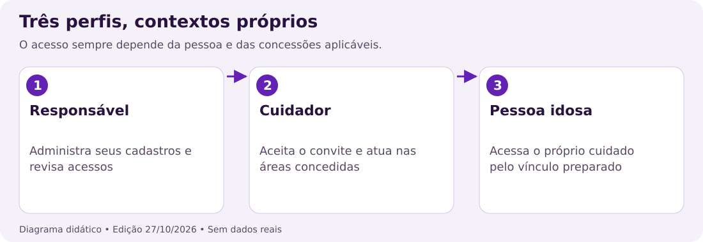
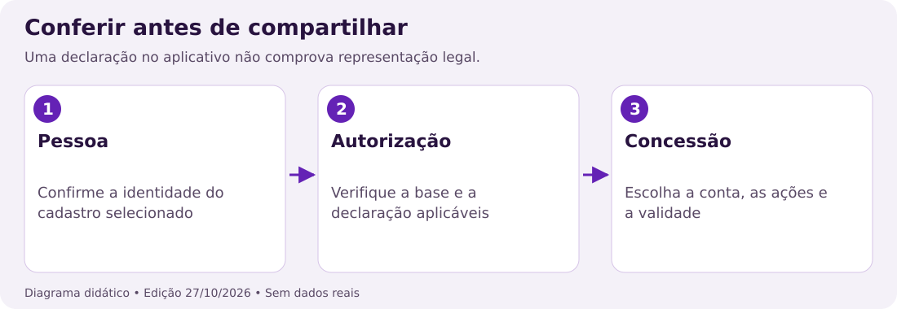
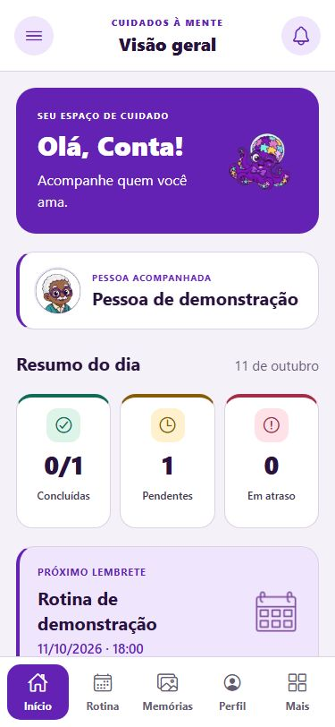
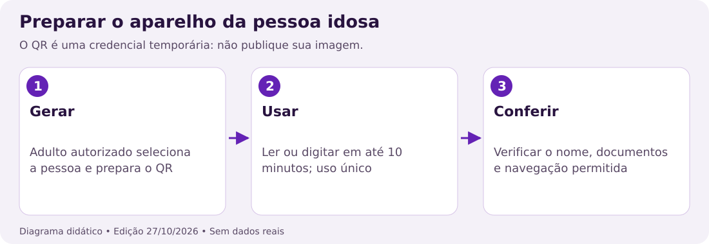
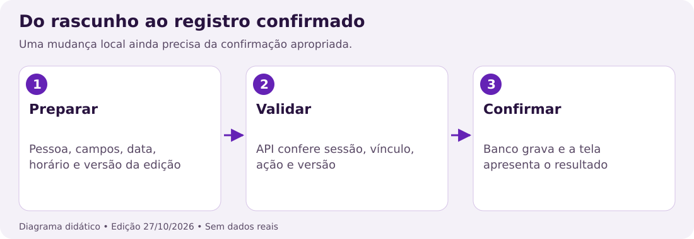
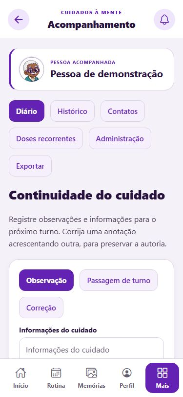
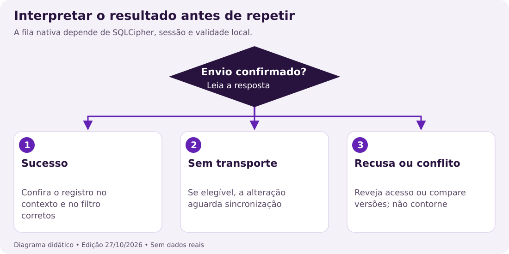
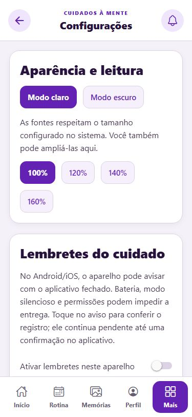
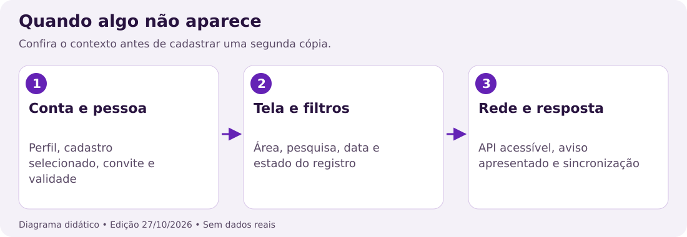
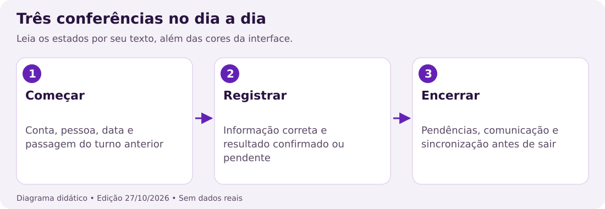

## 30. Guia de leitura e preparação para começar

Este manual atende pessoas idosas, cuidadores e responsáveis. A primeira parte apresenta cada recurso; esta parte reúne roteiros completos para usar esses recursos em conjunto. Não é necessário saber programação. Os capítulos de código da primeira parte são opcionais.

Antes de começar, tenha uma instalação funcionando, uma conta adequada ao seu papel e autorização válida para acompanhar a pessoa. Se você recebeu apenas o código-fonte do GitHub, será necessário executar ou instalar o projeto. O repositório não é, por si só, um serviço já hospedado.

| Se você quer... | Leia primeiro |
| --- | --- |
| Preparar o acompanhamento como responsável | Capítulos 31 a 34 |
| Entrar como cuidador convidado | Capítulos 35 e 36 |
| Usar o aparelho da pessoa idosa | Capítulo 37 |
| Cuidar dos registros no dia a dia | Capítulos 38 a 41 |
| Entender rede, lembretes e conflitos | Capítulos 42 e 43 |
| Resolver dificuldades | Capítulos 47 e 48 |

As capturas representam uma prévia web com dados fictícios. Podem mostrar datas anteriores à edição e opções que mudam conforme perfil, permissão e tamanho da tela. As figuras com setas são diagramas explicativos, não telas de botões que você deve procurar.

**Primeira conferência:** veja se o nome da conta e a pessoa acompanhada estão corretos. Em um aparelho compartilhado, cada adulto deve usar sua própria conta. Isso permite reconhecer quem escreveu e retirar acessos individualmente.

O aplicativo organiza informações declaradas por seus usuários. Registros, resumos e lembretes não substituem orientação profissional, atendimento de urgência nem confirmação presencial de um cuidado.

## 31. Preparar a execução ou receber uma instalação

Quem recebeu o aplicativo pronto deve pedir ao mantenedor o endereço ou a instalação correta. Confirme também quem atende pedidos de privacidade e suporte. Quem recebeu o código pode usar o roteiro abaixo com apoio técnico; as instruções completas ficam em `docs/COMO_EXECUTAR.md`.

| Requisito | Finalidade |
| --- | --- |
| Node.js 22.13 ou superior | Ferramentas do aplicativo |
| JDK 21 | Execução da API Java |
| Dependências com npm ci | Instalação conforme o arquivo de versões |
| API em funcionamento | Contas, permissões e registros |
| Navegador ou build Android/iOS | Interface de uso |

Na pasta raiz, execute `npm ci`. No Windows com PowerShell, inicie `npm run backend` em um terminal e `npm run web` em outro. Deixe os dois processos abertos durante o uso. Para parar, use Ctrl+C em cada terminal.

Em Linux ou macOS sem PowerShell, o mantenedor pode iniciar a API dentro de `backend` com `./mvnw spring-boot:run`, usando JDK 21. O banco padrão é relativo ao diretório de execução. Não mude esse destino de uma instalação existente sem planejar a continuidade dos dados.

No telefone, a API precisa ser alcançável pela rede configurada. `localhost` do telefone não aponta para o computador. O mantenedor deve configurar `EXPO_PUBLIC_API_URL` com a base correta terminando em `/api`, além das origens web permitidas quando aplicável.

**Resultado esperado:** a tela de entrada abre e uma conta de teste consegue consultar a API. Só ver a interface não comprova conexão. Lembretes, GPS e cache offline têm requisitos nativos adicionais; confira a comparação de plataformas no capítulo 46.

## 32. Criar sua conta adulta, etapa por etapa

Abra a entrada e escolha o perfil adequado, Cuidador ou Responsável. O cadastro adulto está dividido em cinco etapas. Use seu próprio e-mail e uma senha exclusiva; as contas citadas em exemplos não são acessos públicos prontos para entrar.

1. Informe um e-mail válido que você consiga consultar.
2. Crie uma senha atendendo aos quatro requisitos mostrados: ao menos oito caracteres, letras maiúsculas e minúsculas, número e símbolo.
3. Informe seu nome. Confira a grafia antes de avançar.
4. Preencha dados adicionais somente quando necessários. Se informar nascimento, use uma data válida; documentos e endereço não são obrigatórios.
5. Leia os Termos de Uso, a Política de Privacidade e a declaração sobre tratamento de dados de saúde. Confirme cada escolha e conclua o cadastro.

O limite técnico do servidor para senha é de 72 bytes; caracteres acentuados podem ocupar mais de um byte. Use o indicador da tela e evite uma frase tão longa que ultrapasse esse limite. Não registre a senha no diário nem a envie ao cuidador.

Se aparecer uma mensagem, leia o campo indicado e corrija a etapa. Avançar entre etapas ainda não significa criar a conta. O envio acontece na conclusão do fluxo. Evite repetir o toque enquanto o aplicativo indica que está salvando.

**Resultado esperado:** após o cadastro aceito, você chega ao painel. Uma lista vazia pode significar que ainda não há pessoas cadastradas ou vínculos aceitos. Não crie uma segunda conta apenas porque o painel começou vazio.

**Se o e-mail já estiver em uso:** volte à entrada e tente recuperar o acesso. O envio de códigos depende da integração de e-mail configurada pelo mantenedor. Sem essa configuração, será necessário suporte da instalação.

## 33. Cadastrar a pessoa acompanhada com o mínimo necessário

Na área de Pessoas ou Contas de idosos, confira se você está usando a conta adulta que deve administrar o acompanhamento. Informe o nome da pessoa e faça a declaração de autorização exigida. O perfil chamado Responsável no aplicativo não comprova, sozinho, representação legal.

1. Abra a ação de novo cadastro disponível ao seu perfil.
2. Informe o nome pelo qual a pessoa deve ser identificada.
3. Preencha dados opcionais apenas se forem necessários à finalidade do cuidado.
4. Leia a declaração e indique corretamente a autorização do titular ou a representação legal aplicável.
5. Salve e confira se o nome aparece na seleção de pessoas.

Ao acompanhar mais de uma pessoa, use os nomes na seleção e leia o cabeçalho completo antes de criar uma rotina, uma dose ou uma memória. Um título parecido não identifica a pessoa. Faça essa conferência novamente ao retornar de outra tela.

**Exemplo fictício:** uma família quer começar apenas com nome, rotinas e um contato de emergência. Ela pode deixar CPF, RG e endereço vazios. Esses campos não são requisitos para experimentar a organização inicial do cuidado.

**Resultado esperado:** o cadastro aparece na conta administradora e pode receber registros. Ele não se torna automaticamente visível para qualquer cuidador; será necessário convite, aceite e concessões de acesso.

Se não houver autorização válida, interrompa o cadastro de dados de cuidado e esclareça a situação com o responsável pela operação. Uma caixa marcada não substitui a verificação real necessária para tratar dados de outra pessoa.

## 34. Reconhecer o painel e navegar sem perder a pessoa

O painel reúne o contexto da pessoa acompanhada, o resumo do dia e as próximas informações disponíveis ao perfil. Leia os rótulos junto com as cores: concluídas, pendentes e em atraso descrevem estados diferentes.

No celular, use a barra inferior e a opção Mais. No computador, o menu lateral oferece os destinos. Quando as letras aumentam, algumas opções mudam de lugar para preservar espaço. A ausência de um atalho na barra não significa necessariamente que o recurso foi removido.

1. Localize o cartão com a pessoa acompanhada.
2. Se houver várias pessoas, escolha a correta.
3. Abra a área desejada, como Rotina, Remédios, Consultas ou Memórias.
4. Confira de novo a pessoa e a data ou filtro selecionado.

**Resultado esperado:** a lista corresponde à pessoa e aos filtros atuais. Uma quantidade no resumo do dia não representa o histórico completo de todas as datas. Uma lista vazia também pode resultar de um filtro, de falta de permissão ou da inexistência de registros.

Quando um dado parecer ausente, confira a seleção antes de adicioná-lo outra vez. Isso evita duplicar uma consulta que estava em outro dia ou criar uma rotina para a pessoa errada.

## 35. Convidar um cuidador e conferir o aceite

Cada cuidador deve ter uma conta própria. O responsável usa o e-mail dessa conta para enviar o convite na área Permissões. O convite permanece pendente até a resposta do destinatário; apenas enviar o convite não libera os dados do cuidado.

1. Entre como administrador da pessoa e abra Permissões.
2. Selecione a pessoa correta e informe o e-mail do cuidador existente.
3. Envie o convite e peça ao destinatário que abra Configurações na própria conta.
4. O cuidador confere quem convidou e aceita ou recusa.
5. Depois do aceite, o administrador revisa as permissões específicas.

O convite vale sete dias. Após o aceite, o vínculo começa com validade de 90 dias. A revisão pode conceder nova validade dentro do limite previsto, até um ano. Planeje a revisão antes do vencimento para evitar interrupção do acesso no turno.

**Exemplo fictício:** Lucas recebe um convite para acompanhar a pessoa cadastrada por Marina. Antes do aceite, ele vê quem convidou, sem consultar os registros de cuidado. Após aceitar, as áreas disponíveis ainda dependem das concessões feitas para seu vínculo.

**Se o convite não aparece:** confira a conta e o e-mail exato, peça ao administrador para verificar a situação e a validade. Não compartilhe a senha do responsável como solução. Contas separadas preservam a autoria e permitem encerrar somente o vínculo necessário.

**Resultado esperado:** o cuidador vê a pessoa autorizada e consegue apenas as ações concedidas. Se o acesso vencer, é o administrador que deve revisar o vínculo; reinstalar o aplicativo não renova a autorização.

## 36. Escolher permissões de forma consciente

Permissões são específicas por pessoa, área e ação. Poder ver uma lista não implica poder editar ou excluir. A tela agrupa Rotina, Remédios, Consultas e Banco de memórias, além de acessos adicionais como contatos e relatórios.

| Ação | O que permite | Exemplo de decisão |
| --- | --- | --- |
| Ver | Consultar os itens autorizados | Ler a rotina do turno |
| Adicionar | Criar novos registros | Escrever uma atividade |
| Alterar | Corrigir campos existentes | Ajustar um horário informado |
| Concluir ou reabrir | Mudar o estado do item | Registrar a conclusão declarada |
| Excluir | Remover um item | Apagar um cadastro indevido |

Selecione primeiro a pessoa e depois quem receberá as permissões. Leia os grupos antes de salvar. As opções da pessoa idosa são limitadas ao que esse perfil suporta. Algumas ações administrativas pertencem ao proprietário e não são liberadas simplesmente por marcar todas as áreas.

**Roteiro de conferência:** conceda o necessário, peça ao cuidador para atualizar a tela e verifique uma ação permitida. Depois confira uma ação que deve permanecer bloqueada, sem tentar contornar o bloqueio. Repita para outra pessoa apenas se existir autorização própria para ela.

Localização tem controles específicos de compartilhamento e de autorização individual do cuidador. Ver medicamentos não concede automaticamente acesso ao mapa. A revogação também precisa considerar vínculos e validade, não só a visibilidade de um botão.

**Resultado esperado:** cada pessoa usa o acesso necessário ao seu papel. Se uma ação estiver ausente, o administrador deve conferir a concessão; um link direto não concede uma nova permissão.

## 37. Preparar o acesso da pessoa idosa

O acesso da pessoa idosa deve abrir somente seu próprio cuidado. O administrador pode gerar um QR de uso único ou preparar a alternativa de e-mail e senha. Não use a conta adulta no aparelho da pessoa para evitar que ela receba poderes administrativos.

1. No acesso adulto autorizado, selecione a pessoa correta.
2. Gere o QR e mantenha-o disponível somente durante a preparação.
3. No aparelho da pessoa, abra o acesso por QR, permita a câmera se necessário e leia o código; a digitação é a alternativa disponível.
4. Confira o nome apresentado e acompanhe a leitura dos documentos solicitados.
5. Abra a rotina e verifique os destinos adequados ao perfil.

O QR vale dez minutos e só pode ser usado uma vez. Se expirar, gere outro. Não publique a imagem nem a inclua em um tutorial público, pois ela funciona como credencial temporária de entrada.

A alternativa de senha precisa ser configurada pelo proprietário. Prepará-la invalida acessos técnicos anteriores conforme o fluxo do sistema. Não há uma senha universal para todas as pessoas idosas nem uma senha pública nas imagens deste manual.

**Ao desconectar o acesso:** QR, senha opcional e sessões vinculadas são desativados conforme a ação. Os registros de cuidado são preservados. Para voltar a usar o aparelho, prepare um novo acesso autorizado.

**Resultado esperado:** a pessoa vê seu próprio cuidado e as ações permitidas. Ajuste letras, confira contatos de emergência e peça que ela experimente a navegação com apoio, respeitando sua autonomia.

## 38. Roteiro completo: criar, corrigir e concluir uma rotina

Use um registro de demonstração para aprender antes de escrever informações reais. O roteiro vale como modelo para listas de rotina; medicamentos, consultas e memórias adaptam os campos e as permissões.

1. Abra Rotina e escolha a pessoa acompanhada.
2. Confira o dia e o filtro. Abra a ação de adicionar se ela estiver permitida.
3. Informe um título claro, data, horário e detalhes necessários.
4. Salve, aguarde o resultado e localize o item na lista.
5. Para corrigir, abra a edição, revise os campos e salve novamente.
6. Use Concluir somente quando quiser registrar a declaração correspondente. Reabrir retorna o item ao estado pendente, quando permitido.

**Exemplo fictício:** título “Leitura acompanhada”, dia 28/10/2026, horário 15:00 e detalhe “Separar o livro escolhido pela pessoa”. Se você estiver usando o roteiro em outra data, escolha uma data adequada ao exercício e confira o filtro.

Uma conclusão não comprova que a ação ocorreu fisicamente. Ao lidar com medicamentos, mantenha as orientações profissionais e a conferência do cuidado real. O aplicativo não deve ser usado para decidir uma dose a partir de um cartão pendente.

**Se o item não aparecer:** procure no dia informado, retire filtros de pesquisa e confira a pessoa. Se existir sinal de sincronização pendente, a operação ainda depende do envio ao servidor. Não adicione outra cópia sem investigar.

**Excluir ou corrigir?** Prefira a correção quando o objetivo for ajustar um campo e a permissão existir. Excluir é uma ação própria e deve ser usada com atenção à pessoa e ao item. Consulte o histórico para compreender as mudanças registradas.

## 39. Roteiro completo: doses recorrentes e lembretes

Use Doses recorrentes em Acompanhamento para registrar um plano já orientado. O aplicativo não prescreve a dose, não decide interações e não substitui a conferência da orientação por quem presta o cuidado.

1. Selecione a pessoa, o título e os detalhes necessários.
2. Informe início e fim do período, o intervalo de dias e os horários.
3. Confira o fuso, especialmente se a pessoa ou o aparelho estiver viajando.
4. Revise a quantidade de ocorrências e programe as doses.
5. Abra a lista de medicamentos e confira cada ocorrência.

**Exemplo fictício sem prescrição:** dois horários em dois dias consecutivos produzem quatro registros. Cada ocorrência possui seu próprio estado. Concluir uma não conclui as outras três. O plano usa o fuso informado, e não uma mudança casual de fuso do aparelho.

Os limites implementados incluem até um ano de período, oito horários, intervalo inteiro de 1 a 30 dias e até 730 doses. O começo precisa ser hoje ou depois no fuso escolhido. Se o plano ultrapassar um limite, reduza o período e revise a organização com quem acompanha o cuidado.

Cancelar o plano remove somente doses futuras ainda pendentes conforme o fluxo. Revise os registros restantes depois da confirmação; não presuma que todo o histórico foi apagado.

Para receber avisos, a build nativa deve suportar notificações, a permissão do sistema deve estar ativa e a preferência do aplicativo precisa estar ligada. São preparados até 50 avisos nas próximas 12 horas, dentro da validade da sessão. Abra o aplicativo diariamente e confira o funcionamento em aparelho real.

**Resultado esperado:** ocorrências corretas na lista e, quando todos os requisitos forem atendidos, agenda local de avisos. Tocar no aviso abre o contexto do cuidado; não marca automaticamente a dose como tomada.

## 40. Diário, passagem de turno e histórico de autoria

O diário registra informações de continuidade. O histórico mostra eventos de alteração. Eles respondem a perguntas diferentes: o diário explica o que precisa ser comunicado; o histórico ajuda a saber quem mudou um registro e o que mudou.

No diário, escolha Observação, Passagem de turno ou Correção. Escreva de forma objetiva: o que foi observado, quando ocorreu e o que a próxima pessoa precisa conferir. Evite inserir documentos, senhas ou detalhes sem utilidade para o acompanhamento.

**Modelo fictício de passagem:** “Turno encerrado às 18:00. A atividade de leitura permanece pendente por escolha da pessoa. O livro está na sala. Próximo turno: confirmar se ela deseja retomar.” Esse texto comunica uma situação sem transformar uma intenção em fato concluído.

Uma correção do diário deve ser outra entrada, identificando o conteúdo que está sendo retificado. As anteriores permanecem. O limite de texto é de 4000 caracteres por entrada e a consulta apresenta até 200 entradas; não trate a tela como um arquivo ilimitado.

No histórico, escolha a categoria e confira ação, autor, instante e Antes/Depois. São mostrados até 300 eventos; a retenção técnica padrão é 365 dias, sujeita à configuração operacional. Alterações antigas sem eventos não recebem autoria retroativa.

**Resultado esperado:** a próxima pessoa entende a passagem e consegue consultar a mudança pertinente no histórico quando necessário. Nenhuma dessas telas comprova, sozinha, ingestão de medicamento ou presença física durante uma ação.

## 41. Memórias, arquivos e relatórios

No Banco de memórias, selecione a pessoa, a categoria ou pasta desejada e crie o registro autorizado. Use título e detalhes que ajudem a reconhecer o conteúdo. Peça autorização antes de acrescentar imagens ou relatos de outras pessoas.

Arquivos novos passam pelo envio autenticado e ficam em armazenamento privado da instalação. O fluxo aceita JPEG, PNG, WebP, MP3, WAV e MP4 com formato reconhecido, até 10 MB por arquivo e 200 MB por pessoa. Alterar apenas a extensão não converte um arquivo para um formato aceito.

1. Confirme a pessoa e a permissão de adicionar memórias.
2. Escolha um arquivo de teste permitido pelo seletor da plataforma.
3. Aguarde o envio antes de sair da tela.
4. Salve o registro e teste a abertura pela conta autorizada.

Links antigos para serviços externos podem continuar disponíveis, mas dependem desses serviços. Um arquivo privado exige sessão e permissão na abertura. Uma cópia exportada ou compartilhada passa a exigir cuidado fora do aplicativo.

Para exportar registros em Acompanhamento, escolha um período de até 366 dias e confira as áreas incluídas. Só entram dados autorizados. O formato de impressão ou compartilhamento depende do navegador e da plataforma; revise o resultado antes de entregar a outra pessoa.

**Relatório não é backup.** Ele contém um recorte de informações para leitura, sem necessariamente incluir todas as estruturas, arquivos e controles necessários para restauração. O backup da instalação é responsabilidade operacional e está descrito no capítulo 49.

**Resultado esperado:** a memória abre apenas para quem tem acesso, e a exportação contém a pessoa e o período pretendidos. Não publique relatórios de cuidado em repositórios ou links abertos.

## 42. Usar sem rede e resolver conflito com cuidado

O modo offline exige build nativa própria com SQLCipher e ativação do cache. Ele não é demonstrado pelo funcionamento da web ou do Expo Go. Prepare o recurso enquanto ainda houver rede e confira o comportamento com o mantenedor em um aparelho de teste.

O cache permite trabalhar com registros previamente armazenados dentro da validade de até 15 minutos desde a atualização de acesso prevista pelo fluxo. A fila aceita até 100 alterações. Mídias não fazem parte desse cache. Não conte com uma nova pessoa ou arquivo que nunca foi carregado.

1. Com rede, ative a opção e abra os dados autorizados.
2. Ao perder conexão, observe os avisos e identifique o que está pendente.
3. Reconecte mantendo a mesma sessão e acompanhe a sincronização.
4. Se houver conflito, compare o conteúdo local e o atual do servidor.
5. Copie para um destino privado autorizado somente o que precisa preservar, descarte a alteração local conforme a tela e faça uma nova edição consciente sobre a versão atual.

**Exemplo fictício:** você ajustou um título sem rede enquanto outra pessoa mudou o horário no servidor. Repetir sua cópia inteira sem ler o servidor pode apagar a correção do horário. A conferência deve preservar a informação correta de ambos quando fizer sentido.

Sair da conta, trocar de sessão ou receber uma recusa de acesso limpa cache e fila conforme o mecanismo de proteção. Alterações ainda não sincronizadas podem ser perdidas. Uma revogação feita enquanto o aparelho está desconectado só é conhecida ao reconectar, dentro dos limites de validade local.

**Resultado esperado:** a fila chega ao servidor após revalidação de acesso e versão, ou apresenta uma falha que precisa de decisão. Um item na fila ainda não é uma confirmação de gravação no banco central.

## 43. Ajustar notificações, letras e leitura

Em Perfil, abra Configurações. Escolha o tema e o tamanho de letra adequado, entre a escala padrão e o limite disponível de 160%. A escala do aparelho também pode influenciar a apresentação. Confira se os rótulos continuam legíveis e se você consegue rolar toda a tela.

Para avisos, ative Lembretes do cuidado na build nativa e permita notificações no sistema. Escolha a antecedência de consulta. A opção de detalhes determina quanto conteúdo aparece; em um aparelho compartilhado ou na tela bloqueada, prefira a mensagem discreta.

**Se não chegou um aviso:** confira se o registro está no período agendado, se a sessão continua válida, se o limite da agenda foi atingido e se o sistema operacional permite a entrega. Abra o aplicativo para atualizar a agenda. Economia de bateria e configurações do aparelho precisam de avaliação real.

Receber um aviso não prova que a pessoa leu o conteúdo; tocar nele não conclui o registro. Para corrigir um cuidado, abra sua lista, leia o item e execute a ação apropriada com a permissão necessária.

**Conferência de acessibilidade:** percorra a tela com letras ampliadas, identifique os botões pelos rótulos e teste o leitor de tela se você o utiliza. Relate ao mantenedor qualquer campo cortado ou controle sem descrição, indicando aparelho, tela e tamanho de fonte.

## 44. Localização pontual e contatos de emergência

A localização é enviada por uma ação voluntária da conta idosa vinculada, no próprio aparelho, em primeiro plano. Primeiro o responsável habilita o compartilhamento; cuidadores recebem autorização individual para consultar. O perfil idoso envia sua posição, mas não recebe um mapa de outras pessoas.

1. O responsável confere a pessoa e habilita o compartilhamento autorizado.
2. Cada cuidador que precisa consultar recebe sua concessão específica.
3. No aparelho da pessoa, abra Configurações, permita localização e escolha Enviar minha posição agora.
4. Na conta autorizada, confira horário e precisão antes de interpretar o ponto.

Somente o ponto mais recente é mantido, por até 24 horas. O envio exige captura recente: até cinco minutos de idade, com tolerância técnica limitada para diferença de relógio. A tela não representa rastreamento contínuo nem garante que a pessoa continue naquele lugar.

Se a precisão for baixa, não interprete a posição como um endereço exato. Se não houver ponto, peça uma nova captura voluntária e confira as autorizações. Para interromper, use a ação de apagar o ponto e desligar o compartilhamento.

Contatos principal e alternativo são cadastrados por pessoa em Acompanhamento. Na tela Emergência, escolha o contato e confirme no discador. A chamada depende de aparelho e rede; não ocorre automaticamente e não substitui serviços de emergência.

**Resultado esperado:** o ponto disponível tem contexto de horário e precisão, e o contato correto é mostrado para a pessoa selecionada. Confira esses dados novamente sempre que houver mudança de telefone ou de responsável.

## 45. Privacidade, sessões e saída de pessoas da equipe

Na central de Privacidade, consulte o canal configurado e registre pedidos de acesso, correção, exclusão, revogação ou informação. Descreva o necessário e confira o protocolo. Enviar um pedido não executa automaticamente uma exclusão; existe atendimento operacional.

A revogação de autorização bloqueia novos pedidos de cuidado e remove controles como GPS e QR pendente conforme o fluxo. A central de direitos continua acessível pelas regras próprias da sessão. O mantenedor deve manter um canal real para acompanhar o pedido.

Em Sessões abertas, confira a sessão atual e encerre acessos que você não reconhece. A recuperação de senha encerra todas as sessões da conta. Códigos por e-mail valem 30 minutos e são de uso único. Login repetido pode atingir os limites de tentativas; não continue tentando sem revisar a entrada.

**Quando um cuidador sai:** ele pode retirar o próprio vínculo em Administração, ou o administrador remove o acesso correspondente. Confira todas as pessoas acompanhadas por esse cuidador. Não basta apagar o atalho ou desinstalar o aplicativo de um aparelho.

**Quando muda a administração:** a transferência exige a senha do administrador atual e a confirmação do destinatário com sua própria senha, em até 24 horas. Os registros são preservados, mas acessos técnicos e concessões precisam de nova revisão. O novo administrador deve revisar vínculos e preparar outro QR quando necessário.

**Exclusão exige atenção:** retirar um vínculo, desconectar o aparelho, revogar autorização, excluir uma pessoa e excluir uma conta são ações diferentes. Leia o texto da ação e o alcance antes de confirmar. A troca técnica de proprietário também não transfere representação jurídica.

## 46. Comparação entre web e aplicativo nativo

| Recurso | Web | Build Android/iOS preparada |
| --- | --- | --- |
| Contas e registros conectados | Disponíveis com API acessível | Disponíveis com API acessível |
| Permissões, diário e histórico | Dependem da API e do acesso | Dependem da API e do acesso |
| Preferências de leitura | Disponíveis na interface | Combinam-se com o aparelho |
| Lembretes locais | Não agenda | Exigem módulo, permissão e teste físico |
| GPS pontual do fluxo do projeto | Não é o fluxo nativo de captura | Exige permissão e ação voluntária |
| Fila offline cifrada | Não oferece a implementação nativa | Exige SQLCipher e build própria |
| Arquivos e compartilhamento | Dependem do navegador | Dependem do seletor e do sistema |

O Expo Go ajuda em partes do desenvolvimento, mas não comprova todas as capacidades de uma build própria. Não use um teste visual no navegador como prova de entrega de notificação, criptografia local ou comportamento da câmera e do GPS em aparelho.

Também há diferenças de navegação: menu lateral em janela larga, barra inferior e Mais em janela estreita. As rotas e permissões seguem as mesmas regras de acesso. Se um recurso não aparecer, confira primeiro perfil, concessão e plataforma.

**Para o mantenedor:** ao entregar uma instalação, informe quais plataformas foram avaliadas e quais recursos ainda dependem de configuração. Um PDF descreve o comportamento previsto no código; não certifica uma integração externa nem a disponibilidade de um serviço contratado.

## 47. Resolver problemas sem duplicar informações

| Situação | Primeira conferência | Ação apropriada |
| --- | --- | --- |
| Tela não mostra a pessoa | Conta, convite e validade | Entrar na conta correta ou pedir revisão |
| Lista vazia | Pessoa, data, pesquisa e área | Ajustar filtros antes de cadastrar novamente |
| Botão não aparece | Perfil e permissão da ação | Pedir conferência ao administrador |
| Não consegue entrar | E-mail, perfil e senha | Usar recuperação ou suporte configurado |
| Código não funciona | Tipo, validade e uso anterior | Solicitar um código novo pelo fluxo correto |
| Mudança não salva | Mensagem, conexão e versão | Tratar a causa antes de repetir |
| Arquivo não abre | Sessão, acesso e origem | Atualizar sessão e conferir o arquivo |
| Nenhuma posição | Compartilhamento e captura recente | Solicitar novo envio voluntário |

Se a interface abrir, mas nenhuma consulta funcionar, o problema pode ser a API ou seu endereço. Peça ao mantenedor para conferir o processo do servidor, a base terminando em `/api`, a rede do aparelho e as origens web autorizadas. Não altere dados do banco para tentar reparar uma falha de rede.

Se a conta foi criada, mas a confirmação por e-mail não chega, confira a mensagem da tela. A integração exige chave e remetente verificado do serviço de e-mail. Uma pasta de spam vazia não prova que o servidor conseguiu enviar.

Quando houver conflito, preserve a informação necessária em local privado e siga a comparação. Quando houver recusa de permissão, peça revisão. Reinstalar, repetir o toque ou trocar o relógio do aparelho não resolve esses motivos.

**Ao pedir suporte:** diga o perfil, a tela, a sequência e a mensagem. Use nomes fictícios na reprodução e oculte conteúdo de cuidado em capturas. Nunca envie a senha, o QR utilizável ou um token de sessão.

## 48. O que as mensagens e os estados significam

Os códigos técnicos abaixo ajudam quem presta suporte. Você não precisa decorá-los: a mensagem da tela deve orientar a ação. Anote o código quando aparecer, sem copiar informações privadas de uma requisição.

| Código ou estado | Significado prático | Como prosseguir |
| --- | --- | --- |
| 400 | Algum dado foi recusado | Rever campos e formato |
| 401 | Sessão não é válida | Entrar novamente |
| 403 | A ação não está autorizada | Conferir vínculo, autorização e concessão |
| 404 | Recurso indisponível naquele contexto | Conferir destino e conta com o suporte |
| 409 | Conflito de versão ou operação | Comparar conteúdos antes de reenviar |
| 413 | Arquivo ou envio acima do limite | Reduzir e conferir o arquivo |
| 428 | A versão exigida não foi enviada | Atualizar o fluxo com o mantenedor |
| 429 | Limite de tentativas atingido | Parar repetições e aguardar a janela |
| 503 | Integração indisponível | Pedir verificação da configuração |
| Pendente de sincronização | Alteração ainda precisa de confirmação | Reconectar na mesma sessão e acompanhar |

“Pendente” de uma rotina e “pendente de sincronização” não são equivalentes. O primeiro é o estado do cuidado registrado; o segundo é o estado do envio da alteração. Um item concluído localmente ainda pode aguardar sincronização.

Um indicador de carregamento também não prova sucesso. Aguarde a resposta, leia o aviso e confira o registro no contexto correto. Se o servidor pode ter recebido o envio antes da conexão cair, investigue a lista antes de criar uma nova cópia.

## 49. Atualização, conservação e cópia de segurança

Esta parte se destina ao mantenedor e a quem administra a instalação. Os usuários devem saber quem cuida das cópias e como solicitar continuidade. O banco e os arquivos privados precisam ser preservados separadamente dos fontes do aplicativo.

Os destinos padrão são `backend/data/cuidados.db` e `backend/data/media`, quando a API é iniciada no diretório esperado. Segredos e chaves não devem ser enviados ao GitHub. O repositório contém o código e esta documentação, não uma cópia pública dos dados de cuidado.

Antes de atualizar uma instalação real, planeje a parada, faça uma cópia restaurável e mantenha a versão anterior necessária à reversão. O script de backup usa SQLite e mídia para montar um pacote cifrado e autenticado. Sua operação exige a API parada para manter a consistência do conjunto.

Restaure primeiro em um diretório novo e verifique a integridade, o acesso autorizado e a presença das mídias. Não sobrescreva o banco ativo como teste. Uma cópia não verificada pode falhar justamente quando for necessária.

A chave de recuperação deve ter proteção e disponibilidade próprias. Perder a chave pode impedir a leitura; expor a chave junto da cópia enfraquece sua proteção. Siga `docs/OPERACAO.md` e as instruções do script em vez de improvisar uma rotina manual.

**Exclusões e restauração:** uma exclusão nos dados ativos não elimina automaticamente todas as cópias históricas. O processo de restauração precisa reconciliar exclusões, revogações e acessos. Defina essa responsabilidade operacional antes de depender de um backup para voltar ao serviço.

## 50. Treinamento guiado com dados fictícios

Use um ambiente de demonstração separado. O roteiro exercita a organização sem incluir dados reais e ajuda a identificar diferenças de aparelho, perfil e permissão. Combine o resultado esperado antes de começar.

1. Crie uma conta adulta de teste e uma pessoa fictícia com autorização de demonstração apropriada ao ambiente.
2. Crie uma rotina com título, data e horário fáceis de localizar.
3. Ajuste um detalhe, conclua e reabra o item quando a permissão permitir.
4. Abra o histórico e explique a diferença entre Antes e Depois.
5. Escreva uma passagem de turno e depois uma correção em nova entrada.
6. Convide outra conta de cuidador, aceite e confira uma ação permitida e uma bloqueada.
7. Ajuste letras e tema, localize Mais e volte ao painel.
8. Prepare o acesso da conta idosa, confira a pessoa e o contato de demonstração.
9. Gere um relatório de um período curto e verifique a pessoa e as áreas incluídas.
10. Retire o vínculo de teste e confira que novos pedidos de cuidado são recusados.

Avalie recursos nativos em uma etapa própria: permissão e entrega de avisos, captura voluntária, cache cifrado e reconexão com conflito. Não simule urgências nem faça ligações reais durante a demonstração de contatos.

**Critérios de aprendizado:** a pessoa consegue dizer qual conta está usando, qual pessoa está selecionada, se um item está pendente ou concluído e se uma alteração foi confirmada ou aguarda sincronização. Ela também sabe pedir ajuda sem compartilhar credenciais.

Se uma etapa falhar, registre a dificuldade e a plataforma. Corrija o roteiro ou a implementação com o mantenedor antes de ensinar a mesma sequência a outras pessoas. Ao encerrar, retire os acessos de demonstração e trate os dados de teste conforme a política da instalação.

## 51. Perguntas frequentes e glossário de uso

**Posso acompanhar duas pessoas?** Sim, quando a conta possuir cadastros ou vínculos autorizados para ambas. Confira a seleção antes de toda ação.

**Uma dose concluída significa medicamento ingerido?** Não. Significa que um usuário registrou a conclusão. A conferência real continua sob responsabilidade de quem presta o cuidado.

**O aplicativo marca consulta no estabelecimento?** Não. Ele organiza o registro informado e os avisos locais disponíveis; o agendamento externo precisa ser feito pelo canal adequado.

**O GPS acompanha continuamente?** Não. O fluxo implementado recebe uma captura voluntária e guarda o ponto mais recente por tempo limitado. Leia horário e precisão.

**Meu cuidador viu tudo depois do convite?** Não automaticamente. O convite precisa ser aceito e as ações dependem das permissões da pessoa e da validade do vínculo.

**Posso depender apenas dos avisos?** Não. A entrega depende do aparelho, da permissão, da agenda e da sessão. Mantenha a rotina de conferência adequada ao cuidado.

**O PDF contém senhas para entrar?** Não. Exemplos e imagens são fictícios. Receba credenciais ou convites por um canal privado do mantenedor.

| Palavra | Significado no uso |
| --- | --- |
| Pessoa acompanhada | Cadastro ao qual pertencem os registros |
| Vínculo | Relação de acesso entre conta e pessoa |
| Permissão | Ação específica concedida no contexto |
| Sessão | Entrada autenticada com validade |
| QR | Credencial temporária de acesso vinculado |
| Histórico | Eventos de mudanças nos dados |
| Diário | Anotações de continuidade do cuidado |
| Conflito | Alterações que precisam de comparação |
| Protocolo | Registro de pedido na central de direitos |
| Build nativa | Aplicativo compilado para Android ou iOS |

## 52. Referência rápida para o dia a dia

**Ao começar:** entre na sua conta, confira a pessoa e a data, leia a passagem de turno e observe os registros pendentes. Confirme se o aparelho tem conexão ou se existe uma fila ainda não enviada.

**Ao registrar:** escreva título e detalhes úteis, leia a mensagem de resultado e confira o item. Diferencie uma conclusão declarada de uma comprovação física. Não duplique um envio só porque o resultado demorou.

**Ao terminar:** revise o que permanece pendente, escreva uma passagem objetiva e sincronize alterações antes de encerrar a sessão. Em aparelho compartilhado, verifique a saída da conta depois de tratar a fila pendente.

**Periodicamente:** revise contatos, vínculos, validade e sessões. O mantenedor deve revisar integrações, canal de privacidade, cópias restauráveis e avaliações em aparelho real.

Para os procedimentos completos, consulte [Como executar](../COMO_EXECUTAR.md), [Rotas](../ROTAS.md), [API](../API.md), [Operação](../OPERACAO.md) e [situação das recomendações](../RECOMENDACOES.md). Para aprender o código, use o Manual de sintaxe e o Manual-aula disponíveis no catálogo.

Edição documental: 27/10/2026. A versão dos documentos jurídicos é independente e deve ser conferida nos textos apresentados pelo aplicativo. Os exemplos deste manual não alteram os termos nem a política da instalação.
